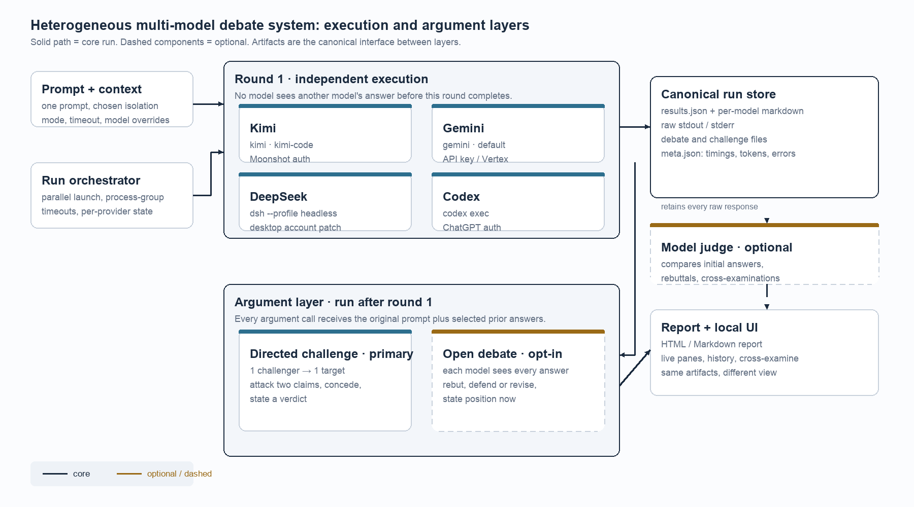
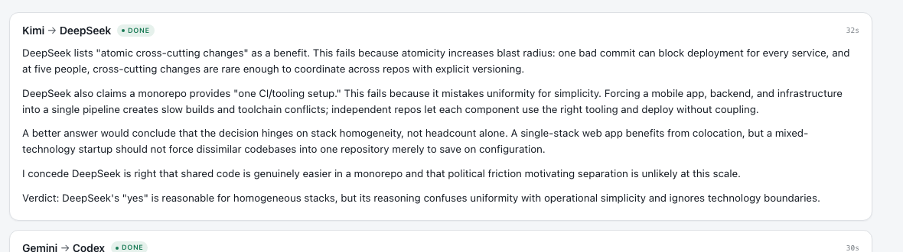

# Directed Cross-Examination in Heterogeneous Multi-Model Agent Systems

## A Design-Science Case Study

**Derek Kramer**  
Independent researcher, Jakarta, Indonesia  
October 2026

**Abstract**

On 20 October 2026 I sent one question to four agent CLIs. Kimi, Gemini, DeepSeek, and Codex all said yes. Their answers ran between 232 and 329 characters, and each used the same three pieces of evidence: shared code, atomic commits, and one CI pipeline. A judge later called the four answers "near-identical in substance." Despite that agreement, the models relied on different assumptions about what a monorepo is, whether headcount should decide the question, and how much blast radius five people can tolerate.

I built a local system, `ensemble`, to make that disagreement visible. It runs the same prompt through four providers, stores every response and raw stream, and then supports either a directed cross-examination, where one model attacks one other model's answer, or an open debate, where every model sees every answer. The account covers the exchanges and the failures that followed. The directed challenge produced a target-specific critique in 32.1 seconds and 1,202 characters. The broadcast debate produced four rebuttals in 145.8 seconds and broad convergence. A state error exposed a gap in the evidence pipeline: the interface showed rebuttals that the report and judge could not see. The judge's complaint exposed it.

This design-science case study documents one deployment. The work contributes a design account, a protocol, a failure taxonomy, and five propositions. It does not establish that debate improves decision quality. One prompt, one user, and no repeated trials cannot support that claim.

**Keywords:** multi-agent debate, large language models, agent orchestration, design science, case study, local-first software, human-AI decision support

## 1. Introduction

### 1.1 A run that agreed too well

I asked whether a five-person startup should use a monorepo, yes or no, with a justification under 50 words. I expected disagreement but received four similar recommendations. Kimi, Gemini, DeepSeek, and Codex all said yes. Their justifications repeated the same benefits. Their explanations differed in emphasis.

That kind of agreement is easy to mistake for confidence. A person comparing models might conclude that the answer is obvious. The run did not support that conclusion. The models used different definitions of a monorepo. DeepSeek treated a monorepo as one repository and one CI setup. Kimi treated it as a coupling decision that increases blast radius. Codex treated it as conditional on having several related services. Gemini treated it as a way to reduce multi-repository overhead.

Comparing independent answers still requires the reader to identify and test each justification. A synthesis pass can compress the pile into a paragraph, but compression hides the conflict. If the judge says "all four agree," it has not told the reader where the agreement is real and where it is a shared assumption.

The first version of the system did what most comparison tools do. It ran the models in parallel, displayed the answers side by side, and offered a synthesis. Readers could compare which answer was clearest, but testing the reasoning required a second phase in which models challenged one another.

### 1.2 Argument as a design problem

Multi-agent debate research has shown that interaction can improve reasoning and factual accuracy (Du et al., 2023; Liang et al., 2024). It has also shown that debate can help a non-expert judge identify a truthful answer (Irving et al., 2018; Khan et al., 2024). Most of that work uses controlled tasks, homogeneous model access, and centralized APIs. The models are usually instances of the same base model or models called through the same interface. The prompts are designed for the experiment, and the evaluation is designed around a benchmark.

A practitioner's setup looks different. The four models arrive as separate agents with separate logins, separate quotas, separate tool policies, and separate output formats. They may change underneath the system. One provider runs out of credit. Another loses an OAuth session. A third rejects a free tier that used to work. The comparison layer has to survive all of that before it can ask whether the models argue well.

The first debate design followed the research pattern. Every model received every answer and wrote a rebuttal. It was a broadcast. The format left the target of each rebuttal unspecified. Each model chose a convenient target. Several rebuttals made the same point. The reader had to reconstruct who was responding to whom. The exchange took two minutes and twenty-six seconds.

The correction came in one sentence: "take Kimi and have it argue against DeepSeek's answer." I changed the system to support one challenger addressing one target answer in a single response. That constraint made the argument easier to attribute and cheaper to run. The rest of the paper examines what the change bought and what it cost.

### 1.3 Research questions

I organized the inquiry around three questions.

**RQ1.** Which architectural and interaction choices make heterogeneous agent CLIs comparable, inspectable, and usable as a multi-model argument system?

**RQ2.** How does directed cross-examination differ from broadcast debate in cost, argument specificity, and auditability?

**RQ3.** Which failures dominate local-first multi-model orchestration, and what do they imply for design?

These questions concern design and practice. They do not ask whether debate makes a model more accurate. The record can show what the system did, what broke, and what the artifacts contain. It cannot establish a causal effect on decision quality.

### 1.4 Contributions

The main contribution is the architecture and the protocol that sits on top of it. `ensemble` wraps four CLIs behind a stable result interface, keeps the first round independent, stores canonical artifacts, and treats argument as a separate call. The directed protocol is short enough to describe in a page and specific enough to audit.

The second contribution is the failure analysis. Building the system exposed a state error that made the interface and the judge disagree about the same run. That error, along with the authentication and operating-system failures around it, says more about the design problem than a feature list would.

The research agenda is smaller: blind judging, structured claims, target responses, and a controlled evaluation. Those are pieces the current work cannot supply.

### 1.5 Scope

The system ran on one macOS machine and used four provider accounts. The analysis focuses on one four-model prompt, two directed challenges, and supporting evidence from 38 run directories. The findings are analytically generalizable to the design problem, not statistically generalizable to other models, tasks, or users. I did not measure answer correctness, user trust, or decision quality.

## 2. Related Work

### 2.1 Debate for reasoning and factuality

Du et al. (2023) had multiple instances of a language model propose answers and reasoning, read one another's responses, and revise over several rounds. Across arithmetic and strategic reasoning tasks, the debate procedure improved performance over individual generation. The authors treated the models as black boxes and used the same procedure across tasks, which made the approach easy to transfer to proprietary systems. The result established a baseline: interaction among model instances can change the final answer.

Liang et al. (2024) found a failure mode they called degeneration of thought. Once a model commits to an answer, self-reflection may not produce a genuinely different alternative. Their multi-agent debate framework put agents into a "tit for tat" exchange and used a judge to manage it. They reported that adaptive termination and a moderate level of conflict were necessary for good performance. They also warned that a judge from a different model family might not be fair.

Wang et al. (2023) offered a non-interactive comparison. Self-consistency samples several reasoning paths and selects the most consistent answer. It improves chain-of-thought performance without any model seeing another model's output. Aggregation alone can help. Debate adds interaction, role asymmetry, and a textual record. The project cares about the record as much as the answer.

### 2.2 Debate for oversight

Irving et al. (2018) proposed debate as a scalable oversight mechanism. Two agents argue opposing positions, and a human or model judge decides which case is more convincing. The setting assumes that the judge cannot directly verify the answer and must evaluate the arguments. Khan et al. (2024) tested a version of that idea with stronger and weaker models. Two expert models debated; a weaker non-expert model or a human judged. Debate raised judge accuracy to 76% for non-expert models and 88% for humans, against naive baselines of 48% and 60%. Optimizing the debaters for persuasiveness improved the judge's ability to find the truth.

Those results support a design intuition: the judge and the roles matter as much as the models. They also carry a warning. A debate can persuade a judge without establishing truth. The work does not test truth. It asks whether a directed challenge produces a record a reader can audit.

### 2.3 Judges and evaluation

Zheng et al. (2023) evaluated strong language models as judges on open-ended questions. The judges agreed with human preferences more than 80% of the time in their setting, but the paper documented position bias, verbosity bias, self-enhancement bias, and limited reasoning. A judge can reward confidence or length for reasons unrelated to correctness. The judge here, DeepSeek, was also one of the four participants. That creates a self-preference risk I cannot rule out.

Chan et al. (2023) moved evaluation into a multi-agent debate. ChatEval uses a team of model referees that discuss and score generated responses. The work treats evaluation as an argument among evaluators rather than a single score. It also makes a design point that matters here: the evaluation protocol is part of the system, not an afterthought.

### 2.4 Orchestration frameworks

AutoGen (Wu et al., 2023) provides a general framework for composing conversable agents with tools, humans, and code. It supports flexible conversation patterns and demonstrates applications in mathematics, coding, question answering, and operations research. ChatEval similarly composes multiple model agents into an evaluation team. Both show that multi-agent patterns can be programmed and reused.

They do not solve the problems the system ran into. A framework assumes that agents are addressable through a common interface. These agents are vendor CLIs with different authentication flows, different tool policies, different quota systems, and different output formats. A framework also assumes that the state of a conversation is available to every component that needs it. The failure shows what happens when that assumption breaks: the interface, report, and judge can tell different stories about the same run.

### 2.5 The gap

The literature says a lot about whether debate improves benchmark performance. It says less about how to build a debate system around agents that were not designed to talk to one another. Four practical questions remain.

How should a system wrap heterogeneous CLIs without erasing their differences? How should argument be scoped when the goal is auditability rather than accuracy? How should state be represented so that every view of a run agrees? Which failures dominate when the system runs locally rather than as a hosted service?

The study addresses those questions through a design artifact and a failure analysis. It does not propose a new debate algorithm. It proposes a way to organize argument as an inspectable layer over heterogeneous execution.

## 3. Method

### 3.1 Design science and the case

I treated the system as a design artifact and studied it in use. Design science research treats an artifact as both a response to a practical problem and a source of design knowledge (Hevner et al., 2004). The artifact here is `ensemble`: its architecture, protocols, artifact model, and interface. The evaluation is formative. I asked whether the design behaved as intended, which failures appeared in practice, and which principles the evidence supported.

The case study follows the reporting guidance of Runeson and Höst (2009). The unit of analysis is the system in use, with two focal runs and supporting operational evidence. I treat it as an instrumental case: the point is to learn about the design problem, not to document every feature. Analytic generalization, not statistical generalization, is the goal.

I did not run a controlled experiment. I did not randomize prompts, repeat runs, blind judges, or collect human ratings. Those are limitations, and Section 8 treats them as such.

### 3.2 Context

The system was built and used by one researcher on a macOS workstation between 19 and 25 October 2026. The final provider set was Kimi, Gemini, DeepSeek, and Codex. Claude was in the first build and came out after its OAuth session expired. Gemini needed an AI Studio API key after Google rejected the free Code Assist tier for CLI clients. The accounts and model versions changed during development, which limits comparisons across dates.

The system is a Python command-line engine and a local HTTP server with a browser interface. It runs each provider as a subprocess, stores every response and raw stream in a run directory, and renders an HTML and Markdown report. A launchd agent keeps the server alive. A small application in `~/Applications` opens the interface from the Dock.

### 3.3 Data

At the time of analysis, the run directory held 38 run directories. I used four kinds of material.

The focal run, R1, is a four-model comparison on the monorepo prompt from 20 October 2026. It contains four initial answers, four open-debate rebuttals, a judge report, timing data, token counts where the provider reported them, and raw stdout and stderr. Two directed challenges were added to R1 on 25 October 2026. C1 is Kimi arguing against DeepSeek. C2 is Gemini arguing against Codex. C2 is a within-case replication of the format with a different pair.

The operational evidence includes CLI error messages, launchd logs, installation scripts, screenshots, and the source code. The remaining run directories are user-generated comparisons and earlier tests. I used them to check whether a failure was unique to the focal run, not as a balanced sample.

The focal prompt was chosen because all four models answered successfully and all four participated in the argument layer. That makes the run informative about the intended use. It also introduces selection bias: the run does not show what happens when several models fail or when the prompt has no clear answer.

### 3.4 Measures and analysis

I measured wall-clock time, per-provider latency, success and failure status, and output length. Those are descriptive and single-run. I did not treat them as benchmarks.

For the arguments, I checked whether a response named its target, quoted specific claims, offered counterarguments, conceded a point, and ended with a verdict. The directed prompt asks for those features, so the check is about protocol compliance, not argument quality. A response can satisfy the format and still be wrong.

The central consistency measure was simpler. Did the interface, the report, the judge input, and the saved artifacts agree about the run state? When they did not, I traced the disagreement to the code or the operating system.

The analysis proceeded in four passes. I extracted metadata and timings from the run directories. I read the initial answers, rebuttals, challenges, and judge reports against the protocol. I traced each inconsistency to its source. I compared the directed and broadcast formats on cost, target specificity, and auditability. The comparison is illustrative. There is one open-debate run, two directed challenges, and no repeated trials.

### 3.5 Position and ethics

I built the system and wrote this account, which creates an obvious risk of confirmation bias. I tried to reduce it by preserving raw artifacts that can contradict the narrative, by including failures that required code changes, and by quoting the judge when it disagreed with the system's presentation. I did not use an independent coder or a second analyst. The design conclusions are informed interpretation, not independent verification.

The study involved no human subjects. The prompts and outputs are model-generated and generic. API keys and credentials remain local and are not reproduced. The tool sent prompts and outputs to the model providers, as any use of those CLIs would. Model outputs can be wrong, and nothing in this paper should be read as factual advice.

### 3.6 Case boundaries and selection

Three things bound the case. The prompt was chosen because all four models answered it and because the initial answers exposed a disagreement about reasoning rather than a disagreement about the recommendation. That makes it a useful case for studying argument, but it is not a representative sample of tasks. A factual question with a verifiable answer, or a question where the models split on the recommendation, would produce a different case.

The provider set was whatever worked on this machine during the study window. Kimi, Gemini, DeepSeek, and Codex were available. Claude was removed after its OAuth session expired, and no attempt was made to replace it with a comparable model. The panel is a convenience sample, not a balanced benchmark panel. The paper describes the panel; it does not claim that the panel represents the model population.

The time window was 19 to 25 October 2026. Provider accounts, model aliases, and quotas were not held constant. A run on 20 October is not directly comparable to a run on 25 October even when the prompt is identical. I use the focal run for the case narrative and the later challenges to examine the argument format. I do not pool timings across dates.

I excluded runs that contained personal prompts, runs that failed before producing any answer, and runs from earlier versions of the argument protocol. The remaining 38 run directories provide context, but the analysis does not treat them as a corpus of independent trials. The unit of analysis is the system in use, with the run directory as the main evidence container and the argument artifact as the main object of inspection.

The selection creates an obvious bias. A prompt that produced four successful answers makes the system look more reliable than a prompt that produced three failures. A prompt that produced a clear disagreement makes the directed challenge look more useful than a prompt where all four answers are correct and similar. I chose the case for what it can reveal about design, not for what it can reveal about average performance.

## 4. System Design

### 4.1 Architecture

The system separates execution from argument. The orchestrator takes a prompt and a set of providers, launches each provider in parallel, applies a timeout, and records the result. The first round is independent: no provider sees another provider's answer. The outputs are normalized into a canonical run store. The argument layer reads that store, constructs one or more argument calls, and writes the results back. The judge, the report, and the interface are readers over the store.

Figure 1 shows the flow. The boundary between execution and argument matters. Execution produces evidence. Argument consumes evidence. The judge consumes both. Every layer reads or writes the same artifacts, which is why a mismatch between layers shows up as a contradiction.

The diagram is a logical view, not a deployment diagram. The orchestrator, HTTP server, and report writer share one Python process. The providers run as child processes. The run store is a directory, not a database, and the browser is an HTTP client with no persistent connection. That simplicity made the system easy to inspect. It also meant that a bug in one reader could look like a bug in the model.

The interface between layers is narrow. The orchestrator returns a list of results and a status. The argument layer takes a challenger result and a target result. The report takes the results, any argument records, and the judge. Only the adapter reads the provider's raw stream. That contract is what lets a directed challenge run against an old run without executing the four initial models again.

The cost of that design is that the run directory becomes an API. Once another tool reads `results.json` or `challenges.json`, the format has to stay compatible or be migrated. I kept the format additive during the case: new fields such as `debate` and challenge records appeared, but existing fields kept their meaning. An older run without a challenge still renders; a newer run with one can be read by an older reader as long as the reader ignores unknown fields. That is a small compatibility policy, not a formal schema, and a production system would need the formal version.



*Figure 1. Architecture of the heterogeneous multi-model debate system. Round 1 is independent and parallel. The directed challenge is the primary argument mode; open debate and the judge are optional. Canonical artifacts are the interface between execution, argument, and presentation.*

### 4.2 Provider adapters

I wrapped the vendor CLIs rather than calling four model APIs. That choice kept the agents' existing logins, tool policies, and quota arrangements, but it moved the integration burden into the adapter layer. Each provider has a different command, a different authentication state, and a different error vocabulary.

**Table 1. Provider integration matrix**

| Provider | Invocation | Authentication | Model used | Observed failure |
|---|---|---|---|---|
| Kimi | `kimi` CLI | Moonshot account | `kimi-code` | 429 errors for insufficient balance on the default account |
| Gemini | `gemini` CLI | Google OAuth or AI Studio API key | `default` | `IneligibleTierError` for the free Code Assist tier in CLI mode |
| DeepSeek | `dsh --profile headless` | Patched desktop account or API key | `deepseek-flash` | Authentication and patch fragility |
| Codex | `codex exec` | ChatGPT account | `default` | No blocking failure observed in the focal run |

Claude was part of the first build and was removed after its OAuth session expired. Its absence is part of the story, not a missing row in the final design. The four remaining providers were chosen because they worked, not because they formed a balanced panel.

The adapter does four things. It builds the provider-specific command, supplies the working directory and timeout, captures stdout and stderr, and normalizes the output into a `Result` object. That object carries key, label, model, status, text, elapsed time, token count when available, cost when available, error, and hint. The argument layer uses the same object for challenges and rebuttals.

### 4.3 The first round

Every model receives the same prompt and a separate working directory. The default context mode is an empty temporary directory. A copy mode gives each model a snapshot of a project. A current-directory mode runs in place when the task requires it. No model sees another model's output before the first round ends.

This has two costs. A model cannot build on another model's useful evidence, and the argument phase waits for every initial call. The benefit is comparability. A first answer is a response to the prompt, not to another model's framing. For a comparison tool, that independence is what makes the answers evidence about the prompt.

Providers run in parallel. A timeout or cancellation kills the process group. A provider failure becomes a failed result, not a failed run. Claude's expired session, Kimi's 429, and Gemini's tier error each produced one error while the other providers answered. The report kept the provider's own error text.

### 4.4 Run artifacts

Each run writes a directory with a prompt file, metadata, results, per-model markdown, raw stdout and stderr, optional debate and challenge files, a judge report, and an HTML and Markdown report. The redundancy is deliberate. Markdown is for reading, JSON is for programs, and raw streams are for debugging. The report is generated from the results, not from a separate copy of the conversation.

The canonical object is the `Result`. A run holds a list of results, and a debate or challenge attaches to the result it belongs to or lives in a separate challenge record. The report writer, judge builder, and interface read those objects. One representation should feed every view. Section 6.4 shows what happened when it did not.

The directory is also the unit of reproduction. A reader can inspect the prompt, the exact output, the timing, and the error without access to the original process. The report can be regenerated. A judge can be rerun. A challenge can be added to an old run without rerunning the four initial models.

### 4.5 The argument layer

The argument layer has two modes. The primary mode is directed cross-examination. One challenger receives the original prompt, the target model's initial answer, and its own initial answer. It is told to quote the two weakest claims in the target, explain why they fail, give counterarguments or missing evidence, state what a better answer would conclude, concede where the target may be right, and end with a verdict. One model, one target, one output.

The secondary mode is open debate. Every successful model receives every initial answer, with its own answer marked. It attacks the strongest claim it thinks is wrong, defends or corrects its own answer, and states its position. Open debate is opt-in. It is broader and more expensive.

Call count matters, but attribution matters more. A directed challenge creates attribution. The output has a named attacker and a named target. A reader can put the challenge next to the target answer and decide whether the attack landed. An open debate creates a group discussion. Each model may attack the easiest target, and the reader has to reconstruct the exchange.



*Figure 2. A directed cross-examination in the web interface. Kimi attacks two claims in DeepSeek's answer, concedes one point, and ends with a verdict. The result is also saved as a Markdown artifact and included in the report.*

### 4.6 Judge and report

The judge is optional. It receives the initial answers, any open-debate rebuttals, and any cross-examinations. It compares positions, identifies strong and weak claims, notes who changed position, and says what to trust where. The judge is a reader with a different prompt, not a source of truth. Its output is stored as `judge.md` and shown in the interface.

The report is generated from the same results and artifacts. It has a summary table, per-model cards, optional rebuttal sections, cross-examination sections, and the judge. The web interface is a live reader over the run store, not a separate database. That kept the system inspectable, but it made the state model critical. If the interface and the report derived state differently, they could disagree.

### 4.7 Local deployment

The server binds to localhost. A launchd agent starts it at login, and a Dock application opens the browser interface. The runtime is copied to `~/.ensemble/app` because macOS privacy controls prevented the launchd agent from reading the source directory in Documents. The installer writes a LaunchAgent, a desktop shortcut, and a Dock entry.

The local-first choice has clear benefits. Prompts and responses stay on the machine, the user does not depend on a hosted account, and the CLIs can use existing subscriptions. It also has costs. The system has to handle macOS privacy permissions, application bundles, launchd state, and code signing. Those costs appear in the failure analysis because they took more time than the argument protocol.

### 4.8 Design principles

Table 2 lists seven principles the work supports. They come from one deployment, not from a universal theory.

**Table 2. Design principles derived from the case**

| ID | Principle | Rationale | Evidence |
|---|---|---|---|
| DP1 | Wrap heterogeneous agents behind a stable result interface | Provider differences should not leak into the comparison layer | Four CLIs with different auth and output formats produced comparable results |
| DP2 | Keep the first round independent | Independence prevents anchoring and makes initial answers comparable | Four initial answers were generated before any argument call |
| DP3 | Make canonical artifacts the interface between layers | One representation prevents the UI, report, and judge from diverging | The split-state bug disappeared after the result object became canonical |
| DP4 | Treat argument as post-processing, not as part of generation | The initial answer should be complete before it is contested | Challenges can be added to an old run without rerunning the initial models |
| DP5 | Give every argument an explicit target and role | Attribution makes the attack auditable and reduces group-discussion drift | Directed challenge produced target-specific claims in 32.1 seconds |
| DP6 | Treat local-first deployment as an operating-system project | Privacy, launchd, app bundles, and Dock behavior are first-order costs | Multiple failures occurred outside the model layer |
| DP7 | Use the judge as a consistency check as well as an evaluator | A judge that reads the saved evidence can expose missing data | The judge reported that the rebuttal round was absent from the record |

### 4.9 Implementation notes

The implementation is deliberately small. The engine is a single Python file built on the standard library. The server uses `ThreadingHTTPServer`, and each run launches provider processes through `subprocess.Popen` with a new process group. A timeout or a cancellation kills the group rather than the immediate child, which matters when an agent CLI starts its own subprocesses. The report renderer, artifact writer, and provider adapters share the same `Result` type.

A run moves through a small state machine: starting, running, judging, finalizing, and a terminal state of done, partial, error, or cancelled. The open-debate variant adds a debating state. A directed challenge is handled separately because the initial run has already finished. The challenge manager appends the challenge record, writes the report, and exposes the record through the same run endpoint. The interface polls that endpoint rather than holding a WebSocket connection.

The small stack made the failures easier to trace. When the report and judge disagreed, I could inspect `results.json`, the raw streams, and the report writer without searching through a framework. The same choice imposed limits. There is no streaming, no queue, no concurrency cap beyond the provider count, and no background worker that survives a server restart. A challenge that is running when the server stops is lost. For a single-user local tool, those limits were acceptable. For a shared service, they would not be.

The provider adapters do more work than their size suggests. Each one builds a command, supplies environment and working directory, captures both output streams, detects timeouts, and parses the provider's final text. The parsers are heuristic because the CLIs do not share an output schema. The raw streams remain in the run directory so that a parsing mistake can be corrected later. The adapter boundary is where most of the integration risk lives, which is why the provider table is part of the design account rather than an appendix.

### 4.10 The system in operation

`ensemble` has two surfaces. From a terminal, it is a command that runs once and returns a report path. From a browser, it is a small local service over the same run model. Both use the same engine and artifact format. The difference is how much of the process the user wants to watch.

#### 4.10.1 Command surface

The default command takes a prompt and runs every authenticated provider. `--only` and `--skip` narrow the panel. `--model provider=model` overrides a model alias. `--timeout` sets the per-provider limit. `--context temp|copy|cwd` chooses the working-directory mode. `--judge` adds synthesis, `--debate` adds the open round, `--out` changes the run location, and `--open` opens the report. `--json` returns a machine-readable record for scripts. `--strict` turns a provider failure into a non-zero exit code. `--dry-run` prints the commands without running them.

The command surface grew around repeated use. `challenge` takes an existing run and two provider keys. `judge` re-synthesizes an existing run. `doctor --probe` checks authentication by sending a one-word prompt. `providers` lists the detected configuration. `web` starts the local server. `last` opens the newest run. These are small affordances, but they separate a one-shot comparison from a tool a person can use repeatedly.

The CLI and the web interface do not share identical defaults. The web composer enables synthesis by default; the CLI requires `--judge`. That inconsistency is a product decision, not a research finding. It reflects two different use cases: a browser user who wants a complete report, and a terminal user who may want only the raw answers.

#### 4.10.2 Run lifecycle

A run begins in `starting`. The orchestrator launches the provider processes and moves to `running` once the first call is in flight. If open debate is enabled and at least two initial answers succeeded, the run moves to `debating` after the first round. It then moves to `judging` if synthesis was requested, or to `finalizing` if not. The terminal states are `done`, `partial`, `error`, and `cancelled`.

The terminal state is not simply "the process exited." A run is `done` only when every initial result and every open-debate result is successful. A single provider failure produces `partial` if at least one answer succeeded, and `error` if none did. That distinction matters in the interface: a partial run still has a report, and a challenge can still target a successful answer.

Cancellation is allowed while the run is `starting`, `running`, or `debating`. The system marks the run as `cancelling`, kills the provider process groups, and settles into `cancelled`. A cancelled run keeps whatever results were already written, which is why the artifact directory is still useful after a stop.

A directed challenge is not a run state. It starts after the initial run has finished and is tracked as a separate challenge record. A run can be `done` while a challenge is running. The interface accounts for that by treating "run is busy" as either an active run state or a running challenge. The separation is deliberate: the initial evidence should not be rewritten every time someone adds an argument.

#### 4.10.3 Web interface

The browser interface has a history rail, a composer, a readiness list, a run view, a challenge bar, four panes, a challenge section, and a judge section. The composer carries the prompt, provider toggles, context mode, timeout, open-debate toggle, synthesis toggle, and judge provider. The readiness list shows which providers are authenticated but does not block a run.

The run view is a live reader. It polls the run endpoint roughly every 700 milliseconds. It does not use a WebSocket and does not maintain a second database. The panes show status, elapsed time, token counts where available, the cleaned answer, expand and copy controls, and any open-debate rebuttal. When a challenge is running, the challenge bar disables its button and the interface shows a skeleton in the challenge section.

The Cross-examine bar appears after the initial run is terminal and at least two providers have successful answers. If Kimi and DeepSeek are both available, it defaults to that pair. The selects are ordinary HTML selects, not a model browser. The button starts a challenge and then polls until the challenge record is available.

The interface is not a chat. It does not accept a follow-up prompt, a correction, or a free-form question to a single model. It is a control panel over a run directory. That restriction keeps the state model small and makes the evidence easier to compare.

#### 4.10.4 Storage and recovery

Runs live under `~/.ensemble/runs/<run-id>`. The newest run is linked at `~/.ensemble/latest`. Each run contains the prompt, metadata, normalized results, per-model markdown, raw streams, optional debate and challenge files, the judge output, and the report. A challenge writes a new record and regenerates the report without rerunning the initial models.

The run directory is durable in a way the process is not. A challenge can be added to a run created days earlier because the challenge builder needs only the prompt and the saved initial answers. A server restart loses any challenge that was in flight, but it does not lose the completed runs. The LaunchAgent restarts the server; the run store is already on disk.

The storage model is not transactional. Files are written directly, and a crash can leave a partial run. The directory remains inspectable, but there is no rollback. For a personal tool, that is an acceptable tradeoff: a partial artifact is often more useful than a missing one. For a production system, it would need atomic writes, a lock, and a migration policy.

#### 4.10.5 Limits

The implementation is single-process, single-user, and local. There is no authentication, no queue, no rate limiting, and no multi-tenant isolation. The HTTP server is bound to 127.0.0.1. The provider parsers are heuristic because the CLIs do not share an output schema. The interface polls instead of streaming. A provider that changes its output format can break the adapter until the parser is updated.

Those limits are consistent with the artifact's purpose. `ensemble` is a research instrument and a personal comparison tool, not a hosted service. The design keeps the state model simple enough to inspect, which is the property the case needed most.

## 5. Protocol

### 5.1 Initial round

The initial prompt is passed unchanged to each provider. The context mode determines what else the provider sees: an empty directory, a copy of a project, or the current directory. I did not add model-specific instructions in the first round. That keeps the answers comparable and makes provider differences visible.

### 5.2 Directed cross-examination

The directed prompt has four parts: the original prompt, the target answer, the challenger's own answer, and the instructions. The target answer is included because the challenge has to be grounded in what the target said. The challenger's own answer is included for consistency, not as the main content. The instructions are narrow:

```text
You are Kimi. The original prompt was:
[prompt]

--- DeepSeek's answer (the target) ---
[target answer]

--- Your own initial answer ---
[challenger answer]

Argue directly against DeepSeek's answer. Do not restate your own answer
as the main body and do not write a generic essay. Do exactly three things:
1. Quote the two weakest claims in DeepSeek's answer and explain precisely
   why they fail.
2. Give the strongest counterargument or missing evidence for each.
3. State what a better answer would conclude, and where you concede the
   target may be right.

Max 300 words. End with a line starting "Verdict:".
```

The constraints carry a theory of useful critique. Quoting forces the challenger to engage with the target's text. Two claims create a bounded comparison. The concession clause reduces one-sidedness. The verdict gives the reader a compact object to accept or reject. The word limit keeps the challenge from turning into a second essay.

### 5.3 Open debate

The open-debate prompt gives every successful model every initial answer, marks the model's own answer, and asks it to attack the strongest claim it thinks is wrong, defend or correct its own answer, and state its position. It is broader than the directed prompt and runs once per participating model. That makes it more expensive and less attributable.

### 5.4 Judge

The judge receives the initial answers and any argument artifacts. It is asked for a bottom line, areas of agreement and disagreement, a model-by-model assessment, and guidance on what to trust where. When rebuttals or cross-examinations exist, it is told to note who changed position. The judge is not blinded to model identity. Section 8 discusses what that means for the claims.

### 5.5 Stopping rule

The system uses one argument round. A second round would add cost, latency, and more chances for models to converge on a polite compromise. The first round tests whether the challenge changes the answer or the justification. If it does not, a second round is unlikely to change the conclusion. That is a design choice, not an empirical finding.

### 5.6 What the protocol leaves open

A protocol is also a set of omissions. The directed prompt says to quote the two weakest claims, but it does not define "weakest." The challenger decides whether a claim is weak because it is false, because it is unsupported, because it is irrelevant, or because it is stated too strongly. That ambiguity gives the model room to exercise judgment, and it also makes the output harder to score.

The prompt does not require external evidence. A challenger can produce a confident counterargument without checking a source. In the monorepo case, the disagreement was mostly about definitions and tradeoffs, so the absence of retrieval did not dominate. In a factual question, it would. The protocol is designed for reasoning disputes, not for verification.

The target never replies. A directed challenge is one-way by design, which keeps the cost low and the attribution clear. It also means the challenge is tested against the target's initial answer, not against the target's best defense. A two-call exchange would answer a different question: does the challenge survive a response? The current system cannot answer that.

The judge sees model identities. The challenger sees the target's identity. Both facts shape the rhetoric. A blind version would be a different experiment, and likely a better one for measuring argument quality. The current design keeps identities visible because the product is a comparison tool, where knowing which model said what is part of the point.

## 6. Findings

### 6.1 Convergence in the first round

All four models recommended a monorepo. The answers were short, between 232 and 329 characters, and their evidence overlapped. The models did not disagree about the recommendation. They disagreed about the reasoning that made the recommendation conditional.

The judge read the same pattern. It called the first round "near-identical in substance: the same 'shared code + atomic commits + one CI beats theoretical modularity' argument, four times." That judgment is about the text, not about the models' inner reasoning. The text is what a reader has to work with.

### 6.2 What broadcast debate produced

The open debate produced four rebuttals and a real correction. The run took 145.8 seconds; per-model rebuttal times ranged from 11.6 to 70.8 seconds. After the persistence fix, the judge could read the rebuttals and concluded that all four models had converged on a shared correction: a monorepo does not eliminate overhead, it relocates it. No model flipped its recommendation. The debate exposed a shared assumption.

It also produced a group discussion. Each model selected a target from four answers. Three of the four rebuttals attacked Kimi's claims. Kimi had written that a monorepo "eliminates cross-repo tooling" and "removes version-mismatch headaches," which are absolute claims and easy to contest. DeepSeek attacked both. Gemini attacked the same sentence. Codex attacked it too, while keeping its own conditional yes. The concentration was not coordinated; it emerged from the text. That is what a broadcast does. It lets a shared target surface, but it does not assign one.

The exchange was broader than a directed challenge, but it was harder to attribute. If the question is "what does the room think," broadcast debate is useful. If the question is "does this answer survive an attack," it is indirect.

### 6.3 What a directed challenge produced

Kimi's challenge to DeepSeek took 32.1 seconds and produced 1,202 characters. It quoted two claims, attacked them, conceded that shared code is easier in a monorepo, and ended with a verdict:

> DeepSeek's "yes" is reasonable for homogeneous stacks, but its reasoning confuses uniformity with operational simplicity and ignores technology boundaries.

The challenge did not summarize DeepSeek. It named two claims and attacked each one. Atomicity, Kimi argued, increases blast radius: one bad commit can block every service. "One CI/tooling setup" confuses uniformity with simplicity, because a mobile app and a backend do not want the same pipeline. Then Kimi conceded the shared-code point. The result is a record a reader can check against the target answer.

A second challenge, Gemini against Codex, took 29.6 seconds and produced 1,994 characters. It attacked Codex's claim that a monorepo involves "dependency management with little organizational overhead," and it disputed Codex's condition that separate repositories are worthwhile only for genuinely independent access control. The output was longer and more enumerated than C1. That difference is a model difference, not a protocol difference. C2 is not an independent experimental replication, but it shows that the format is not tied to one pair.

Read side by side, the two challenges have the same skeleton. Both identify a target, quote claims, explain a failure, offer a counterargument, concede something, and end with a verdict. The prose around the skeleton varies. C1 is compact and argumentative. C2 is more taxonomic, with numbered claims and longer explanations. A reader can compare the two because the skeleton is stable. That stability is the point of specifying the protocol instead of asking for "a critique."

**Table 3. Observed costs in the focal case**

| Run | Mode | Wall time | Output | Notes |
|---|---|---:|---|---|
| R1 initial | Four independent answers | 5.5 to 21.5 s per model | 232 to 329 characters per answer | All four recommended a monorepo |
| R1 open debate | Four rebuttals | 145.8 s | Four rebuttals | Per-model rebuttal time 11.6 to 70.8 s |
| C1 | Kimi to DeepSeek | 32.1 s | 1,202 characters | Target-specific attack with a verdict |
| C2 | Gemini to Codex | 29.6 s | 1,994 characters | Same protocol, different pair |

The numbers are single-run observations on one machine. The structural point is more reliable: a four-model broadcast makes four argument calls, while a directed challenge makes one. The cost difference follows from the protocol, and the specificity difference follows from the role constraint.

Directed challenge has its own cost. It throws away the other models' perspectives. A reader who wants the full range of objections has to run several challenges or use open debate. The directed format is better for a focused question: does this answer survive an attack from this model? It is not a survey.

### 6.4 The judge and the missing rebuttals

The most useful failure was not a model error. The interface displayed four completed rebuttals. The saved results contained `debate: null` for all four. The report had no rebuttal sections. The judge, reading the saved results, wrote:

> the rebuttal round is not in the record... all four "debate": null, no `*.debate.md` files, and a status still marked "running."

The judge was right. The system had two representations of one run. The interface read a live object; the report and judge read the initial results. The rebuttal had been attached to the first, not the second. A screenshot would have shown a successful debate. The artifact directory showed a run with no debate. The judge exposed the difference.

The fix changed the state model. The rebuttal is attached to the initial result, persisted in `results.json`, and rendered from that result by the interface, the report, and the judge. A later variant of the same mistake appeared with directed challenges. The saved challenge text existed, but the API returned the raw record without rendered HTML. The interface interpreted missing HTML as a failed challenge. The fix was to render at the API boundary.

Both failures have the same shape: two representations of one state, with no invariant forcing them to agree. The judge was useful because it read the evidence rather than the presentation. It functioned as an integration test.

### 6.5 Failure modes beyond the model

Authentication was the first operational shock. Each provider failed in its own way. Claude's OAuth session expired and could not refresh. Kimi's default Moonshot account returned 429 errors for insufficient balance until I switched to `kimi-code`. Gemini's Google login succeeded, but Google rejected the free Code Assist tier for CLI clients with `IneligibleTierError`, so the headless path needed an AI Studio key. None of those were model failures. All of them looked like the tool was broken.

The second shock was the operating system. launchd could not read the source directory in Documents, so the runtime moved to `~/.ensemble/app`. The Desktop application sat behind iCloud and App Management permissions that the shell could not remove. The applet's resource fork overrode the custom Dock icon. The LaunchAgent ended up in a disabled state, and the installer ignored the bootstrap failure, so the app stopped opening after a restart. The debate code was not the hard part. The macOS lifecycle was.

**Table 4. Failure taxonomy**

| ID | Failure | Manifestation | Root cause | Response | Design implication |
|---|---|---|---|---|---|
| F1 | Broadcast abstraction | Four rebuttals, repeated points, weak attribution | Every model was both target and source | Directed challenge became primary; open debate optional | A debate needs an explicit target |
| F2 | Split state representation | UI showed rebuttals; report and judge saw `null` | Rebuttal stored in a live object, not the canonical result | Attach argument to the result; persist; render from one source | Canonical state is a correctness requirement |
| F3 | Render-state mismatch | Saved challenge text existed; UI said "Challenge failed" | API returned raw text without rendered HTML | Add rendering at the API boundary | Every view needs a complete representation |
| F4 | Authentication heterogeneity | 429, expired OAuth, `IneligibleTierError` | Separate accounts, quotas, and entitlement rules | API key, model alias, provider-specific fallbacks | Auth is a first-order integration cost |
| F5 | Operating-system integration | Server would not start after restart; generic icon; protected app | launchd disabled state, TCC, iCloud, app bundle metadata | Enable agent, copy runtime, minimal app, dockutil | Local-first is an OS lifecycle project |
| F6 | Evaluation gap | No correctness or trust measure | Single-user case, no blind ratings, no repeated runs | Treat findings as design evidence; propose evaluation | Argument quality needs an external criterion |
| F7 | Test coverage gap | Early bugs were found by screenshots and judge complaints; a 116-test stdlib suite was added after the case | Tests arrived after the design work and cover parsers, config, sanitization, artifacts, and the HTTP API, not end-to-end providers or the UI | Regression suite added; end-to-end and UI tests remain future work | Tests improve confidence but do not replace evaluation |

The failure table is not a scorecard. F1 and F2 changed the design. F6 and F7 describe what this work cannot claim. The operational failures matter because they determine whether anyone can use the artifact at all.

### 6.6 Propositions

Five propositions follow from the work. "Supported" means consistent with the artifacts and the design experience. It does not mean statistically confirmed.

**Table 5. Propositions and evidence status**

| ID | Proposition | Status | Evidence |
|---|---|---|---|
| P1 | Explicit targets and roles increase argument specificity and attribution relative to broadcast debate | Illustratively supported | Directed challenge named two target claims and a verdict; broadcast debate produced broader, less attributable rebuttals |
| P2 | A canonical artifact representation is necessary for consistent interface, report, and judge behavior | Supported | The split-state bug disappeared when the result object became canonical |
| P3 | Provider authentication and entitlement heterogeneity is a first-order integration cost | Supported | Three providers failed for different authentication reasons |
| P4 | Local-first deployment shifts engineering effort toward operating-system lifecycle work | Supported | TCC, launchd, app bundle, and Dock failures consumed substantial time |
| P5 | A model judge can function as a consistency check on the evidence pipeline | Observed | The judge identified missing rebuttal data that the interface displayed as present |

### 6.7 Cost and latency

The cost of an argument round is easy to state in calls and harder to state in time. The independent round makes four calls. Open debate makes four more. A directed challenge makes one. For a four-model panel, that is a 4:1 difference in argument calls. The observed wall times were 145.8 seconds and 32.1 seconds, a ratio of 4.5. The ratio is not exactly four because the providers have different latencies and because the broadcast waits for the slowest rebuttal. Kimi took 70.8 seconds in the broadcast and 32.1 seconds as the challenger. The slowest participant sets the clock.

That detail matters for the interface. A user waits for the whole round, not for the average call. Streaming would make the wait more legible, but it would not reduce the total. A directed challenge is easier to justify because the user can name the question it answers: does this answer survive an attack from this model? Open debate asks a broader question and charges the user for four attempts.

The case does not support a monetary comparison. Token counts were reported for some providers and not others. The effective cost depends on subscription arrangements that changed during the week. The call-count comparison is the part that travels: broadcast scales with the number of participants, directed challenge does not.

### 6.8 What the test suite adds

The test suite arrived after the case narrative, not during the design work. It is a stdlib `unittest` suite of 116 tests. It covers the provider parsers with inline fixtures, configuration merging, Markdown and HTML sanitization, artifact round-trips, and the HTTP API. It also includes regression tests for three defects the suite found: a newline-obfuscated `javascript:` URL, non-object JSONL lines, and a `"defaults": null` configuration.

The suite changes the engineering claim from "manual verification only" to "partially verified." It does not execute a real provider CLI, does not exercise a live challenge, and does not drive the browser interface. A test can confirm that a result with a debate round serializes and renders. It cannot confirm that the model produced a good argument. That distinction is why the evaluation gap remains separate from the test gap.

The suite also illustrates the difference between regression coverage and research evidence. The three regressions are concrete and repeatable. The design claims in this paper are not. A reader should treat the tests as support for the implementation, not as support for the argument that directed challenge improves decisions.

## 7. Discussion

### 7.1 Argument needs a target

The first design treated debate as a group activity. Every model got every answer. The result was a discussion, not an argument. Each model chose a convenient target, and the reader had to reconstruct the exchange. The directed challenge changed the unit of analysis from the group to the pair. That made the output shorter, cheaper, and easier to audit.

The lesson is not that pairwise debate is always better. Broadcast debate is better for surveying the space of objections. Directed challenge is better for stress-testing a specific answer. The design should expose both and choose a default for the task. Here, the user's correction set the default.

What makes the directed version work is accountability. A named attacker and a named target create a record that can be checked. A group discussion creates a transcript that has to be interpreted. For decision support, the difference matters. The reader needs to know which claim was contested and what evidence was offered.

### 7.2 The artifact as the source of truth

The persistence bug is the strongest argument for the artifact-first design. A user could see four completed rebuttals in the interface. A reader of the report saw none. The judge saw `debate: null`. The system had two state representations and no invariant that forced them to agree. The judge's complaint made the inconsistency visible, but the problem was structural.

A canonical state model solves the immediate bug and enables a broader property: every view can be regenerated from the same evidence. A reader can compare the interface, the report, and the judge input and expect them to agree. When they do not, the system has a defect, not a difference of interpretation.

The failure also suggests a role for judges beyond scoring. A judge that reads the saved evidence can detect missing evidence. That is a form of runtime verification. It does not replace tests, but it is useful in a system whose outputs are heterogeneous and probabilistic.

### 7.3 The judge is a reader

The judge is both an evaluator and an instrument with known biases. Zheng et al. (2023) documented position, verbosity, and self-enhancement effects. The system adds a practical observation: a judge that sees model names and reads a partial record can produce a coherent narrative that is wrong about the record itself. The judge's complaint about the missing rebuttals was useful because it was grounded in the artifacts. Its content judgments are less trustworthy.

A stronger design would blind the judge to model identity, use several judges, and report disagreement. It would also separate the judge from the participants. The current judge, DeepSeek, is one of the four models. That creates a self-preference risk I cannot quantify.

### 7.4 Local-first means OS work

Local-first deployment is attractive for privacy, cost, and account ownership. It also makes the operating system part of the product. The system ran into privacy controls that blocked the launchd agent from reading the source directory, an iCloud and App Management restriction around a Desktop application, a generic Dock icon caused by applet metadata, and a launchd service that remained disabled after an installer run.

Those are not edge cases for a local tool. They are the conditions under which it is used. A hosted service would move them to an operator, but it would also require uploading prompts and outputs. The choice is a tradeoff between operational simplicity and data control, not a purely technical preference.

### 7.5 Implications for design

A few design priorities follow. Define the argument protocol before adding models; a clear target and role structure is worth more than another participant. Make the artifact model canonical before building multiple views, so the interface stays a reader rather than becoming a second database. Treat authentication and operating-system integration as product requirements. Instrument the pipeline so missing evidence is visible.

For researchers, benchmark accuracy is not the only dependent variable. Argument specificity, attribution, auditability, and state consistency are design outcomes that matter in decision support. They can be measured with human raters, blinded judges, and repeated runs. They can also be compared across argument formats on the same prompts with a pre-registered rubric.

### 7.6 Argument artifacts and decision support

The tool does not produce a decision. It produces a record that a person can use while making one. That distinction matters because the interface can make a contest look settled. A verdict at the end of a challenge reads like a conclusion, even when it is one model's attempt to discredit another. The report should keep the initial answer, the attack, the concession, and the verdict visibly connected, so the reader can see which claim was tested and what the challenger offered in its place.

Different readers need different things from that record. An engineer may want the specific defect: a missing condition, a false absolute, a tooling assumption that does not hold. A manager may want to know which answer is safe to act on and which caveat changes the decision. The same artifact can serve both, but only if the interface does not collapse the argument into a score. The current report shows the text and the route. A stronger version would let a reader click a challenged claim and see the paragraph that attacked it.

Argument quality and decision quality are separate. A challenge can be well structured and still persuade for the wrong reason. The judge can reward confidence. The challenger can attack a straw man. The target can be right for reasons the challenger ignores. The case cannot resolve those possibilities because it has no external criterion. What it can do is make them visible. A reader who sees the target text, the quoted claim, and the counterargument is in a better position than a reader who sees a single score.

That is also the limitation of using a model as the judge. The judge adds another interpretation to a record that already contains several. It is useful as a reader and as a consistency check. It should not be presented as an authority. The interface labels the judge as a synthesis, not a verdict, and the report keeps the judge's text separate from the challenges. That separation is a small design decision with a large effect on how the output is read.

## 8. Threats to Validity

The construct measured here is protocol compliance, not argument quality. I checked whether a challenge named its target, quoted claims, offered counterarguments, conceded a point, and ended with a verdict. Those features are necessary for the intended argument, but a challenge can satisfy them and still be wrong. I did not measure correctness or usefulness to a decision maker.

The internal comparison is weak. The open-debate and directed runs used different numbers of calls, different dates, and different model states. Timing differences cannot be attributed only to the protocol. Model versions, account quotas, and provider load changed during the week. The judge saw model identities and was one of the participants. The observed differences fit the design explanation, but they do not prove it.

External validity is limited by the design. One user, one machine, four providers, one focal prompt, one week. The findings may not transfer to other model combinations, tasks, or organizations. The design principles are stated at a level that should travel, but their value elsewhere is an empirical question.

Reliability is limited by the lack of repetition. Language model outputs are stochastic. A second run could produce different arguments or timings. I performed the qualitative analysis myself, without an independent coder. Another analyst might classify the failures differently.

I preserved raw artifacts, quoted the judge when it contradicted the presentation, included a second directed challenge, and reported failures that required code changes. Those measures improve traceability. They do not eliminate bias. The appropriate conclusion is analytic, not statistical.

**Table 6. Validity threats and residual risk**

| Threat | What it affects | Response in this study | Residual risk |
|---|---|---|---|
| Construct | Argument quality is inferred from protocol compliance | Separate structure from quality; report exact text | A well-formed challenge can still be wrong |
| Internal | Timing and format differences are confounded | Compare call structure and artifacts, not only wall time | Model and account changes cannot be undone |
| External | One prompt, four providers, one user | State the boundary; use principles rather than population claims | Transfer to other tasks is unknown |
| Reliability | Single runs and one coder | Preserve artifacts; include a second challenge; quote the judge | Another run or coder may classify differently |
| Researcher | Builder interprets own system | Include failures that forced code changes; quote contradictory judge output | Confirmation bias remains possible |
| Ecological | Local macOS tool, not a team workflow | Describe the deployment and its OS constraints | Team use may expose different failures |

The table does not remove the threats. It makes them part of the argument. A reader can disagree with my interpretation and still inspect the artifacts that produced it.


## 9. Future Work

The obvious next step is a controlled evaluation. A fixed prompt set, repeated runs, blinded human ratings, and a pre-registered rubric would let a study compare independent answers, self-consistency, directed challenge, open debate, and judge-only synthesis on the same questions. It could measure whether debate changes the answer, whether the change is justified, and whether a reader can verify the claims.

A feasible design would use prompts from four categories: factual questions with a checkable answer, design questions with defensible alternatives, policy questions with value disagreement, and ambiguous questions with no clear answer. Each prompt would run under five conditions: independent answers, self-consistency with several samples, directed challenge, open debate, and judge-only synthesis. Three repetitions would be enough to see variance without making the study unmanageable. Two raters, blind to condition, would score argument quality and decision confidence. A subset would be fact-checked against sources. The outcome would be a comparison of formats, not a leaderboard of models.

The protocol also needs structure. Free-form rebuttals are hard to compare. A JSON object with claims, evidence, confidence, target claim, counterargument, and concession would make the argument machine-readable. The report could render a claim graph and show which attacks landed. The prose would remain, but the structure would be inspectable.

Directed challenge is currently one-way. A two-call exchange, attack then response, would test whether the challenge survives a reply. The exchange should stop after one response. A long debate rewards stamina, not truth.

Judging needs more work. The judge should not see model names. Several judges should score the same run, and the system should report disagreement. That would reduce brand and self-preference effects and make uncertainty visible. Evidence checking would help too. A debate between models with no retrieval can amplify confident errors; requiring sources would change what the arguments look like.

The engineering work is less interesting but necessary. Streaming, per-challenge cancellation, token budgets, and caching would make the system usable for shorter interactions. A signed application, one runtime location, Keychain storage, an expanded end-to-end and UI test suite, and a health check that verifies the server would make it reliable enough for a broader study.

An engineering evaluation would ask different questions from a model evaluation. How often does the server survive a restart? How often does a provider change break the parser? How long does a new provider take to integrate? How many state mismatches appear per hundred runs? Those are measurable, and they matter more to a user than a small difference in argument quality. The case suggests that these questions deserve as much attention as the debate protocol.

## 10. Conclusion

The four model CLIs still agree that a five-person startup should probably use a monorepo. What changed is the visibility of the reasoning. The first round showed four versions of the same answer. Broadcast debate showed a shared assumption being corrected. Directed cross-examination showed one model attacking another model's specific claims. The interface and report showed the difference between a debate that happened and a debate the system claimed had happened.

The evidence supports explicit challenge targets and one canonical state. The saved artifacts document the observed exchanges and failures. Repeated trials are needed to assess whether the protocol improves decisions, and a blind judge would be a better test of the arguments themselves.

## References

Chan, C.-M., Chen, W., Su, Y., Yu, J., Xue, W., Zhang, S., Fu, J., & Liu, Z. (2023). *ChatEval: Towards better LLM-based evaluators through multi-agent debate.* arXiv:2308.07201. https://doi.org/10.48550/arXiv.2308.07201

Du, Y., Li, S., Torralba, A., Tenenbaum, J. B., & Mordatch, I. (2023). *Improving factuality and reasoning in language models through multiagent debate.* arXiv:2305.14325. https://doi.org/10.48550/arXiv.2305.14325

<span class='nowrap'>Hevner, A. R., March, S. T., Park, J., & Ram, S. (2004). Design science in information systems research. <em>MIS Quarterly, 28(1)</em>, 75-105.</span> https://doi.org/10.2307/25148625

Irving, G., Christiano, P., & Amodei, D. (2018). *AI safety via debate.* arXiv:1805.00899. https://doi.org/10.48550/arXiv.1805.00899

Khan, A., Hughes, J., Valentine, D., Ruis, L., Sachan, K., Radhakrishnan, A., Grefenstette, E., Bowman, S. R., Rocktäschel, T., & Perez, E. (2024). *Debating with more persuasive LLMs leads to more truthful answers.* arXiv:2402.06782. https://doi.org/10.48550/arXiv.2402.06782

Liang, T., He, Z., Jiao, W., Wang, X., Wang, Y., Wang, R., Yang, Y., Shi, S., & Tu, Z. (2024). *Encouraging divergent thinking in large language models through multi-agent debate.* In Proceedings of the 2024 Conference on Empirical Methods in Natural Language Processing. arXiv:2305.19118. https://doi.org/10.48550/arXiv.2305.19118

<span class='nowrap'>Runeson, P., & Höst, M. (2009). Guidelines for conducting and reporting case study research in software engineering. <em>Empirical Software Engineering, 14(2)</em>, 131-164.</span> https://doi.org/10.1007/s10664-008-9102-8

Wang, X., Wei, J., Schuurmans, D., Le, Q., Chi, E., Narang, S., Chowdhery, A., & Zhou, D. (2023). *Self-consistency improves chain of thought reasoning in language models.* In International Conference on Learning Representations. arXiv:2203.11171. https://doi.org/10.48550/arXiv.2203.11171

Wu, Q., Bansal, G., Zhang, J., Wu, Y., Li, B., Zhu, E., Jiang, L., Zhang, X., Zhang, S., Liu, J., Awadallah, A. H., White, R. W., Burger, D., & Wang, C. (2023). *AutoGen: Enabling next-gen LLM applications via multi-agent conversation.* arXiv:2308.08155. https://doi.org/10.48550/arXiv.2308.08155

Zheng, L., Chiang, W.-L., Sheng, Y., Zhuang, S., Wu, Z., Zhuang, Y., Lin, Z., Li, Z., Li, D., Xing, E. P., Zhang, H., Gonzalez, J. E., & Stoica, I. (2023). *Judging LLM-as-a-judge with MT-Bench and Chatbot Arena.* In Advances in Neural Information Processing Systems 36. arXiv:2306.05685. https://doi.org/10.48550/arXiv.2306.05685

## Appendix A. Prompt Templates

### A.1 Initial round

The provider receives the user prompt without additional model-specific instructions. The context mode determines the working directory and any project snapshot.

### A.2 Directed challenge

```text
You are {challenger}. The original prompt was:
{prompt}

--- {target}'s answer (the target) ---
{target_answer}

--- Your own initial answer ---
{challenger_answer}

Argue directly against {target}'s answer. Do not restate your own answer as
the main body and do not write a generic essay. Do exactly three things:
1. Quote the two weakest claims in {target}'s answer and explain precisely
   why they fail.
2. Give the strongest counterargument or missing evidence for each.
3. State what a better answer would conclude, and where you concede the
   target may be right.

Max 300 words. End with a line starting "Verdict:".
```

### A.3 Open debate

```text
The models answered the same prompt independently. Each model now receives
all initial answers, with its own answer marked.

--- Prompt ---
{prompt}

--- Initial answers ---
{answers}

--- Your own answer ---
{own_answer}

Attack the strongest claim you think is wrong. Defend or correct your own
answer. State your position now. Do not simply restate your first answer.
```

### A.4 Judge

```text
Compare the answers and the argument rounds for the following prompt.

--- Prompt ---
{prompt}

--- Initial answers ---
{answers}

--- Rebuttals and cross-examinations ---
{arguments}

Write: (1) a bottom line, (2) where the models agree and disagree, (3) which
arguments landed and which failed, (4) a model-by-model assessment, and
(5) what to trust where. Note who changed position. Do not invent agreement.
```

## Appendix B. Artifact Schema

Each run directory contains the following files:

| File | Contents |
|---|---|
| `prompt.md` | The prompt as submitted |
| `meta.json` | Version, prompt, models, debate flag, timings, status, results |
| `results.json` | Normalized results, including optional rebuttals |
| `<model>.md` | Cleaned initial answer |
| `<model>.stdout.txt` | Raw provider stdout |
| `<model>.stderr.txt` | Raw provider stderr |
| `<model>.debate.md` | Optional open-debate rebuttal |
| `challenge-*.md` | Directed cross-examination |
| `challenges.json` | Challenge metadata and text |
| `judge.md` | Optional synthesis |
| `report.html` | Rendered report |
| `report.md` | Markdown report |

The `Result` object contains `key`, `label`, `model`, `status`, `text`, `elapsed`, `tokens_total`, `cost`, `error`, `hint`, `stdout`, `stderr`, and an optional `debate` result. The challenge record contains `id`, `from_key`, `from_label`, `to_key`, `to_label`, `status`, `text`, `error`, `hint`, `elapsed`, `tokens_total`, `model`, and `created_at`.

## Appendix C. Focal Run Details and Reproduction

**Focal prompt.** "Should a 5-person startup use a monorepo? Answer yes or no, then justify in under 50 words."

**Focal run R1.** Four providers, open debate, judge. Initial answers: Kimi 247 characters in 12.8 s; Gemini 329 characters in 10.5 s; DeepSeek 232 characters in 5.5 s; Codex 303 characters in 21.5 s. Open-debate rebuttals: Kimi 70.8 s, Gemini 25.9 s, DeepSeek 11.6 s, Codex 19.1 s. Total wall time 145.8 s.

**Challenge C1.** Kimi to DeepSeek, 32.1 s, 1,202 characters, status ok. Challenge C2: Gemini to Codex, 29.6 s, 1,994 characters, status ok.

**Reproduction commands.**

```sh
ensemble "Should a 5-person startup use a monorepo? Answer yes or no, then justify in under 50 words."
ensemble challenge ~/.ensemble/latest --from kimi --to deepseek
ensemble challenge ~/.ensemble/latest --from gemini --to codex
ensemble --debate "Explain when a monorepo helps and when it hurts."
```

**Environment.** macOS, October 2026; Python 3.9; local HTTP server; providers as listed in Table 1; accounts and quotas varied during development.

**Availability.** The case study, architecture figure, and prompt templates are in the project directory. The run artifacts are local because they contain model output and account-specific error text. They can be shared selectively after review.

## Appendix D. Case Chronology

The chronology is deliberately coarse. Provider failures happened during development, and I did not keep a timestamped incident log for every authentication error. The table records the events that can be tied to artifacts.

**Table 7. Case chronology**

| Window | Event | Evidence |
|---|---|---|
| Build window, before 20 October | Claude removed after its OAuth session expired; Kimi default account returned 429s; Gemini CLI hit `IneligibleTierError` | CLI error output; provider notes |
| 19 to 20 October | CLI and local web interface built; four-provider round and report working | Source; run directories |
| 20 October | Focal run R1: four initial answers, four open-debate rebuttals, judge report | `meta.json`, `results.json`, `judge.md` |
| 25 October | Directed challenges C1 and C2 added to R1; challenge bar added to the web UI | `challenges.json`, screenshots |
| 25 October | Split-state and render-state bugs fixed; report regenerated | Code changes; judge output |
| 25 October | Case study drafted and revised | This document |

The chronology shows why the case is not a clean experiment. The protocol, the interface, and the provider accounts all changed during the same week. The focal run captures the system after the open-debate feature worked. The challenges capture it after the directed feature worked. The failures capture the transitions between those states.

## Appendix E. Glossary

**Agent CLI.** A vendor-supplied command-line program that runs a language model with its own authentication, tools, and output format. The four agents in this case are Kimi, Gemini, DeepSeek, and Codex.

**Canonical artifact.** A saved file that every view of a run reads from. In this system, `results.json` and the per-model markdown files are canonical; the interface and report are derived views.

**Challenge record.** The saved output of one directed cross-examination, including the challenger, the target, the status, the text, the timing, and the token count when available.

**Directed cross-examination.** An argument call in which one model receives one other model's answer as its target and is asked to attack specific claims, concede what is right, and state a verdict. It is the primary argument mode in the final system.

**Judge.** A model call that reads the initial answers and any argument artifacts and writes a comparison. It is optional and is not treated as ground truth.

**Open debate.** An argument call in which every successful model receives every initial answer and writes a rebuttal. It is broader and more expensive than a directed challenge, and it is off by default.

**Run.** One execution of a prompt across a set of providers, stored in a directory with metadata, results, raw streams, and a report.

**Run directory.** The filesystem container for a run. It holds the prompt, metadata, normalized results, raw streams, argument artifacts, judge output, and report.

**Provider adapter.** The code that builds a provider-specific command, supplies its working directory and timeout, captures its streams, and normalizes its output into a `Result`.

**Artifact-first design.** A design stance in which saved files, not a live session or a UI state, are the source of truth. Every view is generated from the artifacts.

**Argument round.** One pass in which models read prior answers and produce a rebuttal or challenge. The final system uses at most one such round per run.

**Broadcast debate.** The open-debate format in which every successful model receives every initial answer and writes a rebuttal. It is distinguished from a directed cross-examination, which has one challenger and one target.

**Split-state failure.** A failure in which two components represent the same run differently, so the interface, report, or judge can disagree about what happened. The term is used in this paper for the rebuttal-persistence and challenge-rendering bugs.


## Appendix F. Reproduction Checklist

A reader who wants to repeat the focal case can use the following checklist. It assumes the four CLIs are installed and authenticated.

1. Run `ensemble doctor --probe` and confirm which providers are authenticated. Do not assume that a provider that worked last week still works.
2. Record the provider versions and account states, because the model aliases and quotas change.
3. Run the focal prompt with `--judge` and no `--debate` to produce the independent round and the synthesis.
4. Inspect `results.json` and confirm that every expected provider has a result. A missing result is a finding, not a cleanup step.
5. Run `ensemble challenge ~/.ensemble/latest --from kimi --to deepseek` and inspect the challenge record.
6. Open `report.html` and compare the interface, the report, and the judge input. If they disagree, preserve the run directory before changing code.
7. Record the wall time, per-provider time, output length, and any provider error text.
8. If the system is running as a local service, check that the LaunchAgent is enabled and that the server survives a restart.

The checklist is intentionally short. The point is not to standardize every prompt. It is to make the evidence reproducible enough that another reader can see where a claim came from.

## Appendix G. Ensemble Command and API Reference

### G.1 Command surface

**Table 8. Command surface**

| Command | Purpose | Useful options |
|---|---|---|
| `ensemble "prompt"` | Run the four-provider comparison | `--only`, `--skip`, `--model`, `--context`, `--timeout`, `--judge`, `--debate`, `--out`, `--open` |
| `ensemble challenge <run>` | Make one model argue against another model's saved answer | `--from`, `--to`, `--model`, `--timeout`, `--json`, `--open` |
| `ensemble judge <run>` | Re-synthesize an existing run | `--provider`, `--model`, `--timeout`, `--open` |
| `ensemble web` | Start the local browser interface | `--port`, `--open`, `--no-open` |
| `ensemble doctor --probe` | Check provider readiness with a one-word prompt | `--only`, `--strict`, `--no-color` |
| `ensemble providers` | List detected providers and configuration | `--quiet` |
| `ensemble last` | Open the newest run | `--open` |

The run command also accepts `--prompt-file`, `--json`, `--quiet`, `--sequential`, `--keep-workdirs`, `--strict`, and `--dry-run`. The last two are useful for automation: `--strict` makes a provider failure visible to a shell script, and `--dry-run` prints commands without launching them.

### G.2 Run states

**Table 9. Run and challenge states**

| State | Meaning |
|---|---|
| `starting` | The run directory exists; provider processes are being prepared |
| `running` | Initial provider calls are in flight |
| `debating` | Open-debate rebuttals are in flight |
| `judging` | A judge call is in flight |
| `finalizing` | Artifacts and the report are being written |
| `done` | Every expected result succeeded |
| `partial` | At least one result succeeded; at least one did not |
| `error` | No result succeeded |
| `cancelled` | The run was stopped by the user |
| `cancelling` | Cancellation has been requested |

A directed challenge uses its own short state sequence: `running`, then `ok`, `error`, or `timeout`. It does not change the parent run's terminal state.

### G.3 HTTP interface

**Table 10. HTTP endpoints**

| Method and path | Purpose |
|---|---|
| `GET /api/health` | Server version and liveness |
| `GET /api/providers` | Provider readiness, defaults, and model labels |
| `GET /api/runs` | Recent run history |
| `GET /api/runs/<id>` | Live or saved run snapshot, including challenges |
| `POST /api/runs` | Start a run |
| `POST /api/runs/<id>/cancel` | Cancel an active run |
| `POST /api/runs/<id>/challenge` | Start a directed challenge on a finished run |
| `GET /runs/<id>/report.html` | Static report |
| `GET /runs/<id>/judge.md` | Judge text |

The server binds to 127.0.0.1 and has no authentication. That is appropriate for a single-user local tool. It would not be appropriate for a shared machine or a network service.

### G.4 Deployment layout

**Table 11. Deployment paths**

| Path | Role |
|---|---|
| `~/.ensemble/runs/` | Run directories and reports |
| `~/.ensemble/latest` | Link to the newest run |
| `~/.ensemble/app/` | Deployed runtime used by the LaunchAgent |
| `~/.ensemble/gemini.key` | Local Gemini API key, mode 600 |
| `~/Library/LaunchAgents/local.ensemble.web.plist` | LaunchAgent definition |
| `~/Applications/Ensemble.app` | Dock application |
| `~/Desktop/Ensemble.webloc` | Desktop shortcut |

The deployed runtime is a copy, not a symlink. Editing the source tree does not change the running application until the installer copies the files again and restarts the agent. That detail caused a confusing debugging session during the case: the source contained a fix, the browser did not, and the running server was still reading the deployed copy.

### G.5 Reading a run in order

When a report looks wrong, the run directory usually explains why. The order matters.

1. Read `meta.json` for the prompt, provider set, status, and wall time.
2. Read `results.json` for the normalized results and any attached debates.
3. Read `challenges.json` and the `challenge-*.md` files for directed arguments.
4. Read `judge.md` for the synthesis.
5. Read `report.html` last. The report is a view; it is not the evidence.

If the report and the interface disagree, compare both against `results.json`. If the judge describes a round that is not in the files, the judge is reading a different state, not hallucinating a debate.

## Appendix H. Source Map

The design principles are abstractions; the code is where they are enforced or violated. The two tables below trace the main responsibilities to concrete symbols. The point is not to document every function. It is to let a reader move from a claim in the paper to the code that would confirm or contradict it.

### H.1 Engine and artifact layer

**Table 12. Engine and artifact source map**

| File and symbols | Responsibility | Principle | What it makes visible |
|---|---|---|---|
| `ensemble.py`: `load_config`, `provider_settings`, `all_keys`, `gemini_api_key`, `deepseek_account_available` | Provider discovery, authentication state, model defaults | DP1, DP6 | Why a provider is present, skipped, or failing before a prompt is sent |
| `Spec`, `build_specs`, `select_keys`, `parse_models` | Build provider-specific commands and resolve the panel | DP1, DP2 | The exact command line used for each provider |
| `execute`, `kill_tree`, `parse_output`, `hint_for` | Run a subprocess, enforce timeout, capture streams, normalize text and errors | DP1 | Raw stdout and stderr, status, elapsed time, failure hint |
| `Result`, `run_specs`, `Progress`, `print_summary` | Parallel first round and CLI progress | DP2, DP7 | The normalized results that every later layer reads |
| `build_debate_prompts`, `debate_round`, `attach_debates` | Optional broadcast rebuttal round | DP4 | Open-debate text, status, and per-model timing |
| `build_challenge_prompt`, `run_challenge`, `result_to_challenge` | Directed cross-examination | DP4, DP5 | C1 and C2, including the target and the verdict |
| `load_challenges`, `save_challenge` | Persist challenge records | DP3 | `challenges.json` as an independent argument record |
| `result_to_dict`, `dict_to_result`, `write_artifacts`, `load_run` | Serialize and reload the canonical run | DP3 | Whether a debate survives a restart and reaches the judge |
| `render_markdown`, `write_report`, `card_html`, `debate_section_html`, `challenge_section_html` | Render the static report | DP3, DP7 | The report a reader sees, derived from the saved results |
| `build_judge_prompt`, `run_judge` | Construct the synthesis input and write the judge output | DP7 | Which rounds the judge actually received |
| `cmd_run`, `cmd_judge`, `cmd_challenge`, `cmd_doctor`, `cmd_web`, `cmd_last` | CLI entry points and option plumbing | DP1, DP6 | The user-facing commands described in Appendix G |

The split-state bug is visible in this map. `write_report` and `build_judge_prompt` read `Result.debate`. The live server's `snapshot` read `part["debate"]`. For a period, only the second path was populated. The report and judge were not wrong about the data they received; they received a result object with no debate attached.

### H.2 Service, interface, and deployment

**Table 13. Service and interface source map**

| File and symbols | Responsibility | Principle | What it makes visible |
|---|---|---|---|
| `serve.py`: `Run._build`, `Run._worker`, `Run._maybe_finish`, `Run._run_debate`, `Run._finalize`, `Run.cancel`, `Run.snapshot` | Server-side run lifecycle and live state | DP2, DP3, DP7 | Status transitions, cancellation, and the live pane view |
| `Run._debate_result` | Attach an open-debate result to the run and its initial result | DP3 | The exact point where the split-state bug was fixed |
| `ChallengeState`, `start_challenge`, `challenges_for` | Post-run challenge execution and snapshot merging | DP3, DP4, DP5 | A challenge that can run after the run is `done` |
| `derive_status`, `disk_snapshot`, `history`, `Handler` | Saved-run reconstruction, history, and HTTP routes | DP3, DP7 | How an old run is rendered without the original process |
| `web/app.js`: `startRun`, `loadRun`, `startPolling`, `renderPanes`, `updatePane` | Composer, polling, and four-pane rendering | DP3, DP7 | The live view that can diverge from the report |
| `renderChallengeBar`, `startChallenge`, `renderChallenges` | Cross-examine controls and challenge display | DP4, DP5 | How a user selects attacker and target |
| `renderJudge`, `renderHistory`, `showEmpty` | Judge display, history rail, empty states | DP3, DP7 | The parts of the interface that read completed artifacts |
| `desktop/install.sh`, `install-dock.sh`, `launch.sh` | Runtime copy, LaunchAgent, Dock application | DP6 | Why the installed app can lag the source tree |

### H.3 The state fix as a code path

The bug is easiest to explain as a path through the code.

Before the fix, `Run._debate_result` wrote the rebuttal into the live run's `part` dictionary. `Run.snapshot` read that dictionary, so the browser showed four completed rebuttals. `Run._finalize` built its result list from `part["result"]`. Those initial `Result` objects still had `debate = None`. `write_artifacts` serialized them, `write_report` rendered no rebuttal sections, and `build_judge_prompt` sent the judge a record without the round. Every component behaved correctly for the object it received; the objects were not the same.

After the fix, `Run._debate_result` sets `part["debate"]` for the live view and `initial.debate = result` for the canonical result. `result_to_dict` then serializes the debate with the initial answer, `load_run` restores it, and both the report and the judge read the same field. The split is closed by an invariant: the initial result owns its rebuttal, and every view derives from that result.

The challenge path needed a smaller version of the same treatment. `challenges_for` merged saved challenge records and active challenge snapshots, then rendered the text to HTML at the boundary. Before that, the browser received the text but not the HTML, and treated the missing HTML as a failure. The fix did not change the challenge prompt. It changed the representation the interface consumed.

### H.4 What the map does not cover

The map does not include the provider parsers, the report CSS, or every UI state. Those are implementation details that change more often than the design principles. A 116-test stdlib suite now covers the parsers, configuration, sanitization, artifacts, and the HTTP API, but it did not exist during the design work and does not cover end-to-end provider runs, the challenge lifecycle, or the UI. The map is a reading aid, not a verification claim. A reader who wants to verify a specific statement should start with the artifact named in the table, then compare it with the report and the judge.

The source map also shows where the case is weakest. The design principles are implemented across a small number of files, but only a few of them are directly tested by the case. DP1 and DP6 are supported by failures. DP3 is supported by a bug and a fix. DP4 and DP5 are supported by two challenges. DP2 is supported by the shape of the first round, not by an experiment. The uneven evidence is part of the result.
