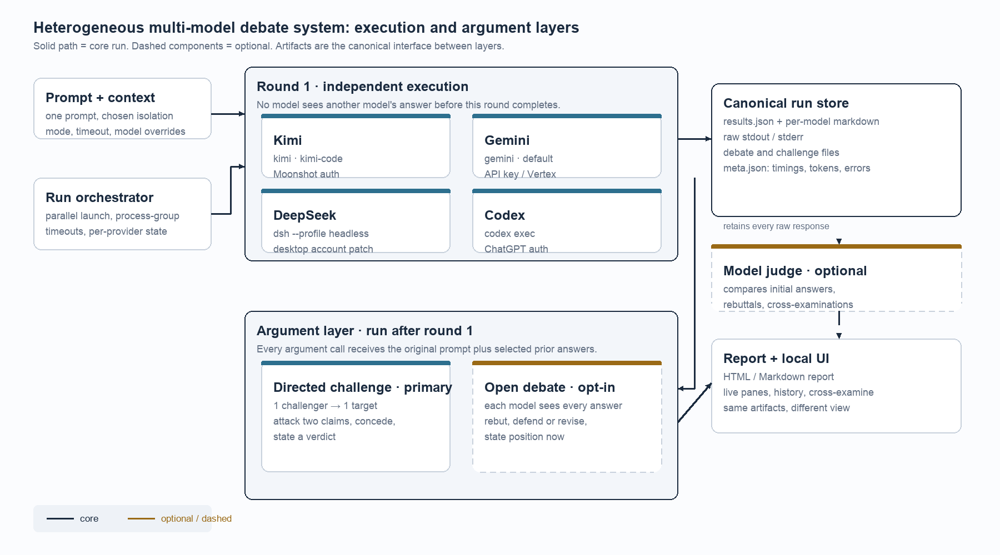

# Directed Cross-Examination in Heterogeneous Multi-Model Agent Systems

## A Design-Science Case Study

**Derek Kramer**  
Independent researcher, Jakarta, Indonesia  
October 2026

**Abstract**

Multi-model comparisons usually present independent answers side by side. That presentation preserves diversity, but it hides the reasoning conflict that matters for a decision. This writing sample reports a design-science case study of `ensemble`, a local system that runs one prompt through four heterogeneous agent CLIs: Kimi, Gemini, DeepSeek, and Codex. After the independent round, the system supports a directed cross-examination in which one model attacks another model's answer, or an optional open debate in which every model sees every answer. The study asks three questions. Which architectural choices make heterogeneous CLI agents comparable? How does directed cross-examination differ from broadcast debate in cost, specificity, and auditability? Which failures dominate local-first orchestration? I analyze 38 run directories, one four-model open-debate run, two directed challenges, raw CLI output, system logs, screenshots, and a 116-test regression suite. The directed challenge produced a target-specific critique in 32.1 seconds and 1,202 characters. The broadcast debate produced four rebuttals in 145.8 seconds and broad convergence. The most consequential failure was a split state representation: the interface displayed rebuttals that the report and judge could not see. The case contributes seven design principles, a protocol, a failure taxonomy, and five propositions. It does not establish that debate improves decision quality. One prompt, one user, and no repeated trials cannot support that claim.

**Keywords:** multi-agent debate, large language models, agent orchestration, design science, case study, local-first software

## 1. Introduction

A practitioner with access to several language models can send one prompt to four systems and receive four answers in under a minute. The comparison is useful, but incomplete. Independent answers are shaped by the prompt, not by one another. When the prompt asks for a recommendation, models often converge on the same recommendation and justify it with the same familiar evidence.

A concrete run illustrates the problem. I asked whether a five-person startup should use a monorepo, yes or no, with a justification under 50 words. Kimi, Gemini, DeepSeek, and Codex all said yes. Their answers ran between 232 and 329 characters. Each used shared code, atomic commits, and one CI pipeline. A judge later called the first round "near-identical in substance."

The agreement hid a disagreement about meaning. DeepSeek treated a monorepo as one repository and one CI setup. Kimi treated it as a coupling decision that increases blast radius. Codex treated it as conditional on several related services. Gemini treated it as a way to reduce multi-repository overhead. Four yeses, four different arguments.

A pile of independent answers does not help a reader adjudicate those arguments. A synthesis pass can compress the pile, but compression hides conflict. If a judge says "all four agree," it has not shown where the agreement is real and where it is a shared assumption.

The first debate design made the problem worse. Every model received every answer and wrote a rebuttal. The exchange took two minutes and twenty-six seconds. Each model chose a convenient target, several rebuttals repeated the same point, and the reader had to reconstruct who was responding to whom. The correction came from the user: "take Kimi and have it argue against DeepSeek's answer." A debate needs a target.

This paper asks three questions. **RQ1:** Which architectural and interaction choices make heterogeneous agent CLIs comparable, inspectable, and usable as a multi-model argument system? **RQ2:** How does directed cross-examination differ from broadcast debate in cost, argument specificity, and auditability? **RQ3:** Which failures dominate local-first multi-model orchestration, and what do they imply for design?

The case can describe what the system did and what broke. It cannot establish a causal effect on decision quality.

## 2. Related Work

Du et al. (2023) had multiple instances of a language model propose answers and reasoning, read one another's responses, and revise over rounds. Debate improved arithmetic and strategic reasoning and reduced fallacious answers. Liang et al. (2024) identified degeneration of thought and proposed a multi-agent debate framework with a judge and a "tit for tat" exchange. They warned that a judge from a different model family may not be fair.

A second line treats debate as oversight. Irving et al. (2018) proposed a judge who evaluates competing arguments when direct verification is hard. Khan et al. (2024) showed that debate can help a non-expert judge identify truthful answers, and that more persuasive debaters improve the judge's accuracy. The judge and the roles are part of the mechanism.

Self-consistency offers a non-interactive comparison (Wang et al., 2023). It samples reasoning paths and selects the most consistent answer. Aggregation can help without interaction. This case is concerned with the record that interaction produces, not only with the final answer.

Judge quality is a known problem. Zheng et al. (2023) documented position, verbosity, and self-enhancement biases in LLM judges. Chan et al. (2023) turned evaluation itself into a multi-agent debate. AutoGen (Wu et al., 2023) provides a framework for composing conversable agents. These systems assume a common agent interface. This case starts from the opposite condition: four vendor CLIs with separate logins, quotas, tools, and output formats.

Design-science research treats an artifact as both a response to a practical problem and a source of design knowledge (Hevner et al., 2004). Case study reporting requires a clear unit of analysis, a chain of evidence, and explicit threats to validity (Runeson & Höst, 2009). The gap this case addresses is practical: how to wrap heterogeneous CLIs, scope argument for auditability, and keep the interface, report, and judge from telling different stories.

## 3. Method

### 3.1 Design

I treated the system as a design artifact and studied it in use. The evaluation is formative. I asked whether the design behaved as intended, which failures appeared in practice, and which principles the evidence supported.

The case study follows Runeson and Höst (2009). The unit of analysis is the system in use, with two focal runs and supporting operational evidence. I treat it as an instrumental case: the point is to learn about the design problem, not to document every feature. Analytic generalization, not statistical generalization, is the goal.

### 3.2 Context and data

The system was built and used by one researcher on a macOS workstation between 19 and 25 October 2026. The final provider set was Kimi, Gemini, DeepSeek, and Codex. Claude was removed after its OAuth session expired. Gemini required an AI Studio key after Google rejected the free Code Assist tier for CLI clients. Accounts and model versions changed during development, which limits comparisons across dates.

At the time of analysis, the run directory held 38 run directories. The focal run, R1, is a four-model comparison on the monorepo prompt from 20 October 2026. It contains four initial answers, four open-debate rebuttals, a judge report, timing data, token counts where reported, and raw stdout and stderr. Two directed challenges were added on 25 October 2026. C1 is Kimi arguing against DeepSeek. C2 is Gemini arguing against Codex.

### 3.3 Measures and analysis

I measured wall-clock time, per-provider latency, success and failure status, and output length. I checked whether an argument named its target, quoted specific claims, offered counterarguments, conceded a point, and ended with a verdict. That is protocol compliance, not argument quality. I also checked whether the interface, report, judge input, and saved artifacts agreed on the same run state.

The analysis proceeded in four passes: extract metadata and timings; read the argument artifacts against the protocol; trace inconsistencies to code or operating system; compare directed and broadcast formats on cost and attribution. The comparison is illustrative. There is one open-debate run, two directed challenges, and no repeated trials.

### 3.4 Position and limits

I built the system and wrote this account, which creates a risk of confirmation bias. I preserved raw artifacts that can contradict the narrative, included failures that required code changes, and quoted the judge when it disagreed with the system's presentation. I did not use an independent coder. The study involves no human subjects.

### 3.5 Case selection and reflexivity

The monorepo prompt was chosen because all four models answered it and because the initial answers exposed a disagreement about reasoning rather than a disagreement about the recommendation. That makes it useful for studying argument, but it is not a representative sample of tasks. A factual question with a verifiable answer, or a question where the models split on the recommendation, would produce a different case.

The provider set was a convenience sample. Claude was removed after its OAuth session expired, and no attempt was made to replace it with a comparable model. The accounts and model versions changed during the week. I do not pool timings across dates.

I also had a stake in the system working. I reduced that risk by preserving artifacts that can contradict the narrative, by including failures that required code changes, and by quoting the judge when it disagreed with the interface. I did not use an independent coder. The design conclusions are informed interpretation, not independent verification.

## 4. System and Protocol

The system separates execution from argument. The orchestrator runs each provider as a subprocess, captures stdout and stderr, and normalizes the output into a `Result`. The first round is independent: no provider sees another provider's answer. The results are written to a run directory with metadata, per-model markdown, raw streams, and an HTML and Markdown report. The judge and the interface read the same files.

*Figure 1. Execution and argument are separate layers. Canonical artifacts are the interface between them.*

The primary argument mode is directed cross-examination. One challenger receives the original prompt, the target model's initial answer, and its own initial answer. It is told to quote the two weakest claims in the target, explain why they fail, give counterarguments or missing evidence, state what a better answer would conclude, concede where the target may be right, and end with a verdict. It is one model call against one target.

The secondary mode is open debate. Every successful model receives every initial answer, with its own answer marked, and writes a rebuttal. It is broader, more expensive, and off by default.

The design difference is attribution. A directed challenge has a named attacker and a named target. A reader can put the challenge next to the target answer and decide whether the attack landed. An open debate creates a group discussion.

The judge is optional. It receives the initial answers and any argument artifacts, and writes a comparison. It is a reader with a different prompt, not a source of truth. The report is generated from the same results. The web interface is a live reader over the run directory.

The system runs locally. A launchd agent starts the server at login, and a Dock application opens the browser interface. The runtime is copied to `~/.ensemble/app` because macOS privacy controls blocked the launchd agent from reading the source directory in Documents.

## 5. Findings

### 5.1 Convergence in the first round

All four models recommended a monorepo. The answers were short and their evidence overlapped. The models did not disagree about the recommendation. They disagreed about the reasoning that made the recommendation conditional. The judge called the first round "near-identical in substance: the same 'shared code + atomic commits + one CI beats theoretical modularity' argument, four times."

### 5.2 Broadcast debate

The open debate produced four rebuttals and a real correction. The run took 145.8 seconds; per-model rebuttal times ranged from 11.6 to 70.8 seconds. After the persistence fix, the judge could read the rebuttals and concluded that all four had converged on a shared correction: a monorepo does not eliminate overhead, it relocates it. No model flipped its recommendation. The debate exposed a shared assumption.

It also produced a group discussion. Three of the four rebuttals attacked Kimi's absolute claims. That concentration emerged from the text; it was not assigned. A broadcast lets a shared target surface, but it does not assign one.

### 5.3 Directed challenge

Kimi's challenge to DeepSeek took 32.1 seconds and produced 1,202 characters. It attacked atomicity as a benefit by pointing to blast radius, attacked "one CI/tooling setup" as a confusion between uniformity and simplicity, conceded that shared code is easier, and ended with a verdict:

> DeepSeek's "yes" is reasonable for homogeneous stacks, but its reasoning confuses uniformity with operational simplicity and ignores technology boundaries.

A second challenge, Gemini against Codex, took 29.6 seconds and produced 1,994 characters. It followed the same skeleton with a different pair. C2 is not an independent replication, but it shows that the format is not tied to one pair.

**Table 1. Observed costs**

| Run | Mode | Wall time | Output |
|---|---|---:|---|
| Initial round | Four independent answers | 5.5 to 21.5 s per model | 232 to 329 characters |
| Open debate | Four rebuttals | 145.8 s | Four rebuttals |
| C1 | Kimi to DeepSeek | 32.1 s | 1,202 characters |
| C2 | Gemini to Codex | 29.6 s | 1,994 characters |

### 5.4 The judge and the missing rebuttals

The most useful failure was not a model error. The interface displayed four completed rebuttals. The saved results contained `debate: null` for all four. The report had no rebuttal sections. The judge wrote:

> the rebuttal round is not in the record... all four "debate": null, no `*.debate.md` files, and a status still marked "running."

The system had two representations of one run. The interface read a live object; the report and judge read the initial results. Attaching the rebuttal to the initial result, persisting it, and rendering every view from that result fixed it. A later version of the same mistake appeared with challenges: the saved text existed, but the API did not return rendered HTML, so the interface said the challenge had failed.

### 5.5 Failure modes

Authentication was the first operational shock. Claude's OAuth session expired. Kimi's default account returned 429s for insufficient balance. Gemini rejected the free Code Assist tier with `IneligibleTierError`. Each failure looked like the tool was broken.

The second shock was the operating system. launchd could not read the source directory in Documents, so the runtime moved to `~/.ensemble/app`. The Desktop app sat behind iCloud and App Management permissions. The LaunchAgent was disabled, and the installer ignored the bootstrap failure, so the app stopped opening after a restart.

**Table 2. Failure taxonomy**

| ID | Failure | Root cause | Response |
|---|---|---|---|
| F1 | Broadcast abstraction | Every model was both target and source | Directed challenge became primary |
| F2 | Split state | Rebuttal stored in a live object, not the canonical result | Attach to result; persist; render one source |
| F3 | Render-state mismatch | API returned text without HTML | Render at the API boundary |
| F4 | Authentication | Separate accounts, quotas, entitlements | Provider-specific fallbacks |
| F5 | Operating system | launchd, TCC, iCloud, app bundles | Enable agent, copy runtime, minimal app |
| F6 | Evaluation gap | No correctness or trust measure | Treat as design evidence; propose study |
| F7 | Test coverage gap | Tests came after the design work | 116-test suite; end-to-end and UI tests remain |

### 5.6 Tests after the case

The test suite arrived after the case narrative. It is a stdlib `unittest` suite of 116 tests covering provider parsers, configuration, sanitization, artifacts, and the HTTP API. It includes regression tests for three defects: a newline-obfuscated `javascript:` URL, non-object JSONL lines, and a `"defaults": null` configuration.

The suite changes the engineering claim from "manual verification only" to "partially verified." It does not execute a real provider CLI, exercise a live challenge, or drive the browser. A test can confirm that a result with a debate serializes and renders. It cannot confirm that the model produced a good argument.

## 6. Discussion

The first design treated debate as a group activity. The result was a discussion, not an argument. The directed challenge changed the unit of analysis from the group to the pair. That made the output shorter, cheaper, and easier to audit. The lesson is not that pairwise debate is always better. Broadcast debate is better for surveying objections; directed challenge is better for stress-testing one answer.

The persistence bug is the strongest argument for the artifact-first design. The interface showed a complete debate. The report and judge saw a run with no debate. A canonical state model solves the immediate bug and enables a broader property: every view can be regenerated from the same evidence.

The judge is both an evaluator and an instrument with known biases. Zheng et al. (2023) documented position, verbosity, and self-enhancement effects. This case adds a practical observation: a judge that reads a partial record can produce a coherent narrative that is wrong about the record itself. Its complaint was useful because it was grounded in the artifacts. Its content judgments are less trustworthy.

## 7. Threats to Validity

The construct measured here is protocol compliance, not argument quality. A challenge can satisfy the format and still be wrong. The internal comparison is weak: the open-debate and directed runs used different numbers of calls, different dates, and different model states. The judge saw model identities and was one of the participants.

External validity is limited by one user, one machine, four providers, one focal prompt, and one week. Reliability is limited by single runs and one coder. The tests improve implementation confidence but do not measure the research claim.

The appropriate conclusion is analytic, not statistical.

## 8. Conclusion

The four model CLIs still agree that a five-person startup should probably use a monorepo. What changed is the visibility of the reasoning. Broadcast debate exposed a shared assumption. Directed cross-examination made one model attack another model's specific claims. The interface and report showed the difference between a debate that happened and a debate the system claimed had happened.

The evidence supports explicit challenge targets and one canonical state. The saved artifacts document the exchanges and failures. Repeated trials are needed to assess whether the protocol improves decisions. This case is a design argument, not a completed evaluation.

## References

Chan, C.-M., Chen, W., Su, Y., Yu, J., Xue, W., Zhang, S., Fu, J., & Liu, Z. (2023). *ChatEval: Towards better LLM-based evaluators through multi-agent debate.* arXiv:2308.07201.

Du, Y., Li, S., Torralba, A., Tenenbaum, J. B., & Mordatch, I. (2023). *Improving factuality and reasoning in language models through multiagent debate.* arXiv:2305.14325.

Hevner, A. R., March, S. T., Park, J., & Ram, S. (2004). Design science in information systems research. *MIS Quarterly, 28*(1), 75-105.

Irving, G., Christiano, P., & Amodei, D. (2018). *AI safety via debate.* arXiv:1805.00899.

Khan, A., Hughes, J., Valentine, D., Ruis, L., Sachan, K., Radhakrishnan, A., Grefenstette, E., Bowman, S. R., Rocktäschel, T., & Perez, E. (2024). *Debating with more persuasive LLMs leads to more truthful answers.* arXiv:2402.06782.

Liang, T., He, Z., Jiao, W., Wang, X., Wang, Y., Wang, R., Yang, Y., Shi, S., & Tu, Z. (2024). *Encouraging divergent thinking in large language models through multi-agent debate.* In Proceedings of EMNLP 2024. arXiv:2305.19118.

Runeson, P., & Höst, M. (2009). Guidelines for conducting and reporting case study research in software engineering. *Empirical Software Engineering, 14*(2), 131-164.

Wang, X., Wei, J., Schuurmans, D., Le, Q., Chi, E., Narang, S., Chowdhery, A., & Zhou, D. (2023). *Self-consistency improves chain of thought reasoning in language models.* In ICLR 2023. arXiv:2203.11171.

Wu, Q., Bansal, G., Zhang, J., Wu, Y., Li, B., Zhu, E., Jiang, L., Zhang, X., Zhang, S., Liu, J., Awadallah, A. H., White, R. W., Burger, D., & Wang, C. (2023). *AutoGen: Enabling next-gen LLM applications via multi-agent conversation.* arXiv:2308.08155.

Zheng, L., Chiang, W.-L., Sheng, Y., Zhuang, S., Wu, Z., Zhuang, Y., Lin, Z., Li, Z., Li, D., Xing, E. P., Zhang, H., Gonzalez, J. E., & Stoica, I. (2023). *Judging LLM-as-a-judge with MT-Bench and Chatbot Arena.* In NeurIPS 2023. arXiv:2306.05685.
