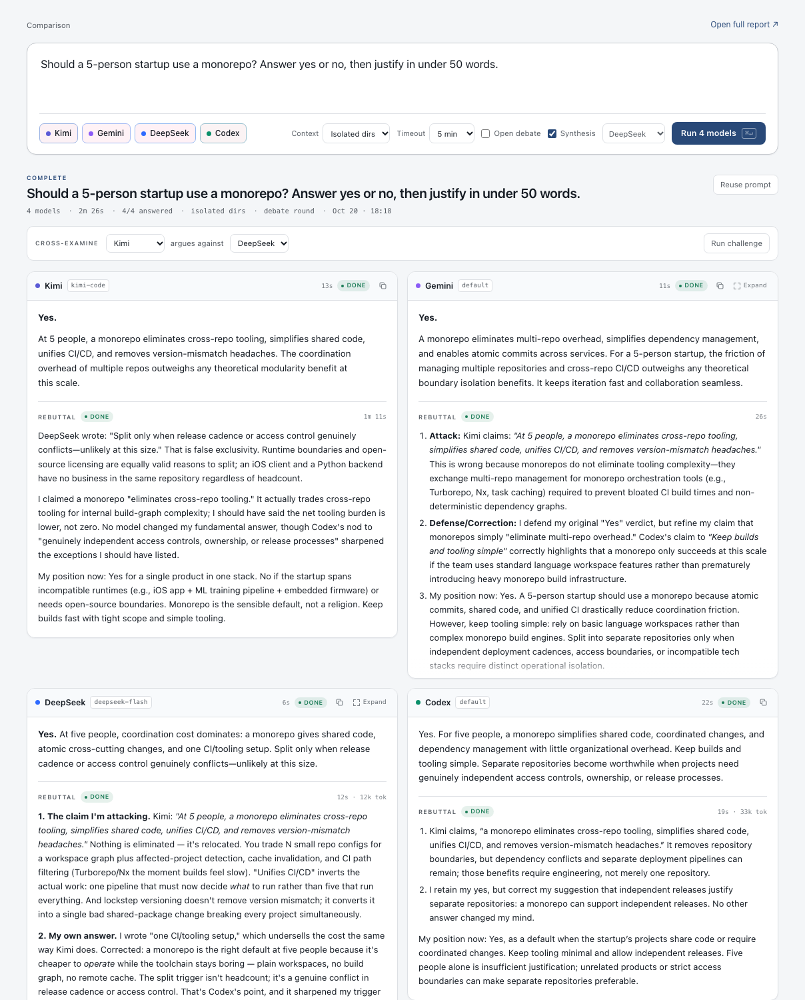
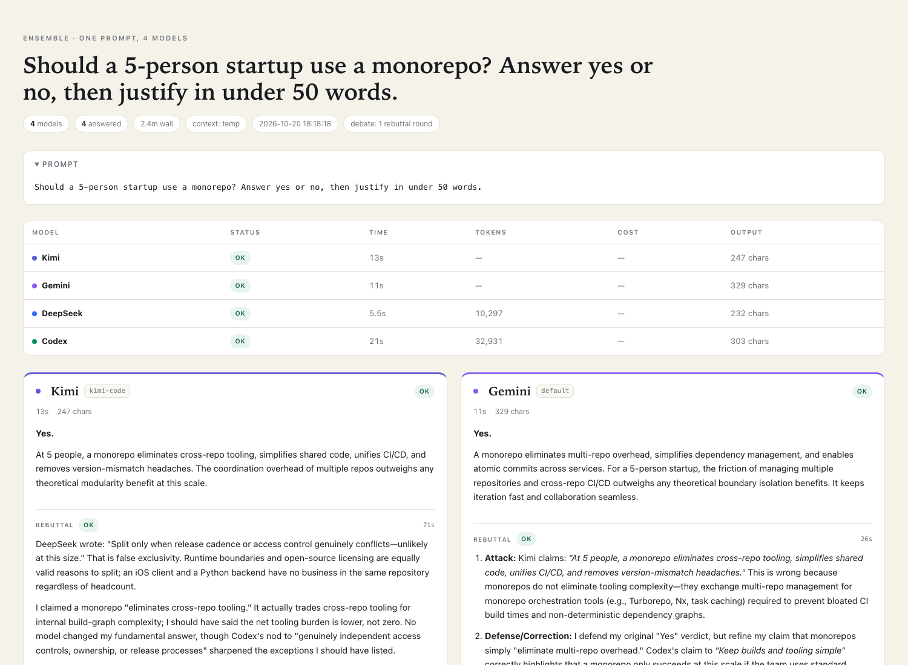

# ensemble

**One prompt. Four models. Side by side.**

`ensemble` sends the same prompt to Kimi, Gemini, DeepSeek, and Codex at the same
time. Each model answers independently. You can then make any model argue
directly against another model's answer — Kimi versus DeepSeek — or opt into an
open debate where every model sees every answer. The report keeps the initial
answers, cross-examinations, timing, token usage, failures, and an optional
synthesis in one place.



Read the case study: [public PDF](CASE_STUDY.pdf) ([Markdown](CASE_STUDY.md)). It is an academic working paper with research questions, related work, a design-science method, a failure taxonomy, threats to validity, and a source map.

**Full-length edition:** [EXPANDED_PAPER.pdf](EXPANDED_PAPER.pdf) ([Markdown](EXPANDED_PAPER.md)), 25,968 words. Adds a formal protocol specification with 14 numbered invariants, a 14-class failure taxonomy, a comparison with adjacent multi-model systems, seven design principles, a cost and latency model built from the measured timings, a controlled study design, and a replication package. Same evidence as the case study; more argument.

**Demo page:** [demo/index.html](demo/index.html) is a static page built from one real run — the prompt, the two answers that came back, the judge synthesis, and the two providers that failed. No JavaScript, no network. Rebuild it from any run with `python3 demo/build.py --run <run-dir>`.

For blind review, use [CASE_STUDY_SUBMISSION.pdf](CASE_STUDY_SUBMISSION.pdf). The submission edition omits the cover, author line, and affiliation. Rebuild either edition with `python3 build_case_study.py` (both), `--public`, or `--submission`.

TOCHI-style editions: [public](CASE_STUDY_TOCHI.pdf) and [anonymous](CASE_STUDY_TOCHI_ANON.pdf). These use a single-column ACM journal layout, CCS concepts, and numeric ACM-style references, built by `python3 build_tochi.py`. They are a CSS typeset approximation of ACM TOCHI because TeX/`acmart` is not installed. The BibTeX source is [references.bib](references.bib).

Shorter academic artifacts:

- [Workshop paper](WORKSHOP_PAPER.pdf), 6 pages
- [Study design](STUDY_DESIGN.pdf), 2 pages
- [Evaluation feasibility memo](EVALUATION_FEASIBILITY.pdf), 2 pages
- [PhD writing sample](PHD_WRITING_SAMPLE.pdf), 10 pages

Build them with `python3 build_short_papers.py`.

```
$ ensemble "Should a 5-engineer startup run Kubernetes? Give a clear recommendation."

MODEL      STATUS      TIME   TOKENS    OUTPUT  MODEL
Kimi       ok           17s        —       906  kimi-code
Gemini     ok           21s        —       771  default
DeepSeek   ok           11s    8,111     1,051  deepseek-flash
Codex      ok           30s   33,847       566  default

  Report  ~/.ensemble/latest/report.html

  $ ensemble challenge ~/.ensemble/latest --from kimi --to deepseek
  Kimi → DeepSeek: ok
```

Gemini is skipped from default runs until `GEMINI_API_KEY` is set (or Vertex is
configured); Google account login alone is blocked for the free tier.

A failed provider never blocks the others. Every run keeps its raw output, so
you can inspect exactly what each CLI said (and what it wrote to stderr).

## Install

```sh
ln -sf "$PWD/ensemble.py" ~/.local/bin/ensemble
ensemble doctor --probe
```

Requires Python 3.9+ and the four CLIs on `PATH`. The CLI is also exposed to
DeepSeek Harness as the `ensemble` skill in `~/.agents/skills/ensemble/`. Nothing is pip-installed;
`report.html` gets nicer Markdown rendering when the `markdown` package happens
to be available, and falls back to preformatted text otherwise.

## Use

```sh
# the local UI: prompt box, live panes, history, synthesis
ensemble web

# all four (Gemini needs GEMINI_API_KEY), isolated from the current directory
ensemble "Explain CRDTs in one paragraph"

# pick models
ensemble --only kimi,codex "Review this idea: ..."

# give the models a copy of the current project (git-aware, one copy each)
ensemble --context copy "Find the riskiest assumption in this codebase"

# run in place (Codex/Kimi/Gemini get read-only/plan flags)
ensemble --context cwd "Review the auth flow"

# long prompts / piped input
ensemble --prompt-file brief.md
cat error.log | ensemble "What is the root cause here?"

# optional open debate: every model sees every answer and rebuts
ensemble --debate "Explain CRDTs in one paragraph"

# have one model argue against another model's answer
ensemble challenge ~/.ensemble/latest --from kimi --to deepseek

# add a judge that compares the answers, rebuttals, and cross-examinations
ensemble --judge "Postgres, SQLite, or DuckDB for a side project?"

# re-judge an existing run with a different model
ensemble judge ~/.ensemble/latest --provider codex
```

Reports open automatically with `--open`. The newest run is always at
`~/.ensemble/latest`.

## Web UI

```sh
ensemble web                 # http://127.0.0.1:8765
ensemble web --port 9000     # another port
ensemble web --no-open       # don't launch a browser
```

The UI is a local control desk, not a chat window:

- **One composer** with model toggles, context, timeout, and synthesis.
- **Live panes** that fill in as each model finishes, with per-model status,
  elapsed time, token counts, and a copy button that puts the raw markdown on
  your clipboard.
- **Cross-examine** any answer with another model: pick challenger and target,
  run it, and read the directed attack below the answers. This is the primary
  way to make the models argue.
- **Open debate** is an opt-in toggle for the all-versus-all version.
- **Expand** a long answer into a full-width reading view; short answers keep
  the comparison grid.
- **History** in the left rail, including runs started from the CLI. Runs are
  shared through `~/.ensemble/runs`. Press `/` to filter the list by prompt and
  `Escape` to clear the filter.
- **Synthesis** appears below the panes when enabled, with the judge's model
  named in the header.
- **Stop** cancels the whole process group; partial answers are still saved.
- **Open full report** goes to the same self-contained HTML report the CLI
  writes.

Model output is rendered through an allowlist HTML sanitiser before it reaches
the page or a saved report, and the server sends a restrictive
`Content-Security-Policy`. Answers are treated as untrusted text, so a model
that echoes hostile markup cannot execute script in the UI.

The server binds `127.0.0.1` only and has no accounts or remote access. Start it
from the directory you want `copy`/`in place` contexts to use.

## Tests

```sh
python3 -m unittest discover -s tests -v
```

Stdlib only, no network, and no provider CLI is invoked: output parsing is fed
inline fixtures and the HTTP tests run against a real local server on port 0
with run construction patched out. See `tests/README.md` for the coverage map.

## Desktop shortcut (macOS)

```sh
./desktop/install.sh      # Dock app + Desktop shortcut + launch agent
./desktop/uninstall.sh    # remove shortcut, agent and runtime copy
```

`install.sh` copies the runtime to `~/.ensemble/app`, registers
`local.ensemble.web` as a LaunchAgent, pins `~/Applications/Ensemble.app` to the
Dock, and puts a shortcut on the Desktop. Dock pinning uses
[`dockutil`](https://github.com/kcrawford/dockutil) (`brew install dockutil`). The server starts at login and restarts
if it exits; the Desktop shortcut simply opens `http://127.0.0.1:8765`.
Re-run the installer after changing `ensemble.py`, `serve.py`, or `web/`.

The runtime lives outside `~/Documents` because macOS blocks launchd agents from
reading Documents without Full Disk Access.

The desktop version of that same run is in
[`docs/web-preview.png`](docs/web-preview.png); the report is below.

## Reports



## What each run produces

```
~/.ensemble/runs/2026-10-19_230752_should-a-5-engineer-startup-.../
├── report.html          side-by-side cards, light/dark, print-friendly
├── report.md            same content for terminals and diffs
├── prompt.md
├── meta.json            timings, models, command, token usage
├── results.json         machine-readable results
├── kimi.md              cleaned initial answer
├── kimi.debate.md       optional open-debate rebuttal
├── challenge-*.md       directed cross-examination
├── kimi.stdout.txt      raw initial stdout
├── kimi.debate.stdout.txt
├── ...                  one set per provider
└── judge.md             when --judge was used
```

## Providers

| Key | Runner | Default model | Authentication |
|---|---|---|---|
| `kimi` | `kimi -p … --output-format stream-json` | `kimi-code` | `kimi login` (Kimi Code plan) |
| `gemini` | `gemini -p … --output-format text` | account default | `GEMINI_API_KEY` (headless) or Vertex |
| `deepseek` | `dsh --profile headless --json` | `deepseek-flash` | DSH desktop account, or `DEEPSEEK_API_KEY` |
| `codex` | `codex exec --json` | account default | `codex login` |

### Gemini

Google account login is not enough for headless Gemini: Google currently rejects
the free Gemini Code Assist tier for CLI clients (`IneligibleTierError`).
Create an API key at <https://aistudio.google.com/app/apikey> and run
`export GEMINI_API_KEY=...`, or configure Vertex AI. `ensemble doctor` shows the
state. Until then Gemini is skipped from default runs and `--only gemini`
reports the exact error; once the key is set it joins automatically.

### DeepSeek and DSH

The DeepSeek runner uses the DeepSeek Harness CLI that ships inside the desktop
app. The headless profile disables the account plugin by default, so `ensemble`
generates a small patch per run that re-enables the account provider and points
it at the existing local DSH credentials. If you are signed in to the app, it
just works.

Alternatives:

```sh
# explicit bundled CLI path
export ENSEMBLE_DSH_PATH="/Applications/DeepSeek Harness.app/Contents/Resources/runtime/cli/bin/dsh"

# or use an API key instead of the desktop account
export DEEPSEEK_API_KEY=...
export ENSEMBLE_DEEPSEEK_AUTH=api-key
```

### Kimi's two accounts

Kimi has both a Moonshot API balance and a Kimi Code subscription. This tool
defaults to `kimi-code` because that is the plan that tends to work without a
separate top-up. If your account is the other way around:

```sh
ensemble --model kimi=moonshot-ai/kimi-k2.6 "…"
```

A `429 ... insufficient balance` means the Moonshot API account needs a top-up
or the model alias needs to point at `kimi-code`.

## Context modes

| Mode | What happens | Use for |
|---|---|---|
| `temp` (default) | Each model gets an empty temp directory | General questions, writing, analysis |
| `copy` | Each model gets its own snapshot of `--cwd` (tracked + untracked files in git repos) | Code review without edit races |
| `cwd` | All models run in the real directory | Deliberate in-place work |

In `cwd` mode Codex gets `-s read-only`, Kimi gets `--plan`, and Gemini gets
`--approval-mode plan`. DeepSeek's headless profile has no read-only switch, so
it keeps normal filesystem access — use `copy` if that matters.

`copy` refuses projects over 400 MB and skips `.git`, `node_modules`, caches,
and build output. Temp copies are deleted after the report unless you pass
`--keep-workdirs`.

## Cross-examination

The primary argument mode is directed:

```sh
ensemble challenge ~/.ensemble/latest --from kimi --to deepseek
```

Kimi receives the original prompt and DeepSeek's initial answer, plus its own
answer for consistency, and is instructed to attack the two weakest claims,
supply counterarguments, concede what is right, and give a verdict. It is one
call, one target, and it is saved as `challenge-*.md`, `challenges.json`, and a
cross-examination section in the report and web UI.

In the web UI the **Cross-examine** bar lets you pick any two models that
answered. A finished run can collect multiple challenges without rerunning the
initial answers.

## Open debate (optional)

`--debate` runs a broadcast round: each model receives every initial answer, is
told which one is its own, and must attack, defend or revise, and state its
position now. It is expensive and produces broader but less pointed criticism
than a directed challenge. It is off by default.

The rebuttal is a separate call per model, run in parallel. It is included in
the report, raw artifacts, and judge prompt. A model that failed its initial
answer is excluded; a failed rebuttal leaves the initial answer intact.

## Judge (cross-model synthesis)

`--judge` sends all successful answers and their rebuttals to one model and asks for:

1. bottom line,
2. consensus,
3. divergence,
4. model-by-model strengths and weak claims, including who conceded or changed position,
5. what to trust where.

It defaults to DeepSeek (cheap and fast) and falls back to the first successful
provider. Choose another with `--judge-provider codex` or the `ensemble judge`
subcommand. Answers are truncated to 14k characters each to stay manageable.

## Configuration

Optional, merged in this order: built-in defaults → `~/.config/ensemble/config.json`
→ `./ensemble.config.json`.

```json
{
  "defaults": {
    "timeout": 420,
    "context": "copy",
    "deepseek_auth": "auto"
  },
  "providers": {
    "kimi": { "model": "kimi-code", "timeout": 600 },
    "gemini": { "timeout": 600 },
    "codex": { "timeout": 600 },
    "deepseek": { "model": "deepseek-flash" }
  }
}
```

### Adding a provider

Any entry under `providers` that is not one of the built-ins becomes a custom
provider:

```json
{
  "providers": {
    "gemini": {
      "label": "Gemini",
      "command": ["gemini", "-p", "{prompt}"],
      "parse": "text",
      "timeout": 180
    }
  }
}
```

Placeholders: `{prompt}`, `{model}`, `{workdir}`. `parse` is one of `text`,
`codex-jsonl`, `kimi-jsonl`, `dsh-jsonl`.

## Scripting

```sh
ensemble --json --only deepseek,codex "…"   # JSON on stdout
ensemble --quiet "…"                         # only the report path
ensemble --strict "…"                        # exit 1 if any model fails
```

Exit codes: `0` success, `1` with `--strict` and a failed provider, `2` bad
input, `130` interrupted.

## Doctor

```sh
ensemble doctor           # binaries, versions, auth state (fast)
ensemble doctor --probe   # one live one-word prompt per model (~20s)
```

`doctor` understands each CLI's own auth command: `codex login status`,
`kimi provider list`, Gemini's credential store, and DSH's credential store. The
`--probe` run tests the actual path end to end and prints the provider's real
error message when something is wrong.

## Design notes

- One thread per provider; `Popen` with `start_new_session=True`.
- Timeouts terminate the whole process group (no orphaned agents).
- Output parsers normalize Codex's JSONL events, Kimi's stream-json, DSH's event
  stream, and Gemini's text output into plain text + metrics.
- `ANSI` escapes are stripped; DSH diagnostics are removed from answers.
- Reports are fully self-contained HTML (no CDN, no JS).

## Troubleshooting

| Symptom | Fix |
|---|---|
| `429 ... insufficient balance` from Kimi | top up Moonshot or use `--model kimi=kimi-code` |
| `Please set an Auth method` from Gemini | export `GEMINI_API_KEY` |
| `IneligibleTierError` from Gemini | free Gemini Code Assist is blocked for CLI clients; use a `GEMINI_API_KEY` |
| `ACCOUNT_SIGN_IN_REQUIRED` from DeepSeek | sign in to the DSH app, or use `DEEPSEEK_API_KEY` |
| `command not found: dsh` | install DSH or set `ENSEMBLE_DSH_PATH` |
| Codex complains about a missing git repo | already handled with `--skip-git-repo-check` |
| All models look slow | first runs include CLI cold start; subsequent runs are faster |
