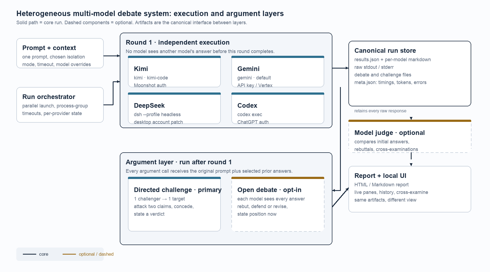
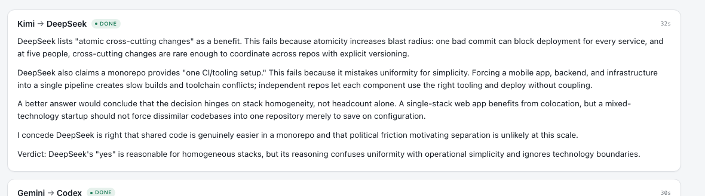

# Directed Cross-Examination: Making Multi-Model Debate Auditable

**Derek Kramer**  
Independent researcher, Jakarta, Indonesia  
October 2026

**Abstract**

Four model CLIs answered the same question and agreed. Their justifications did not. This workshop paper reports a design case for making that disagreement inspectable. `ensemble` runs one prompt through Kimi, Gemini, DeepSeek, and Codex, stores every answer and raw stream, and then supports a directed cross-examination in which one model attacks one other model's saved answer. The directed format produced a 1,202-character critique in 32.1 seconds. A broadcast debate produced four rebuttals in 145.8 seconds. The most useful failure was a state error: the interface displayed rebuttals that the report and judge could not see. The judge's complaint exposed it. The paper contributes a protocol, a canonical artifact model, and a failure analysis. It does not claim that debate improves decision quality; that requires a controlled study.

**Keywords:** multi-agent debate, agent orchestration, design case, auditability, local-first software

## 1. Introduction

I sent one question to four agent CLIs: should a five-person startup use a monorepo, yes or no, with a justification under 50 words. Kimi, Gemini, DeepSeek, and Codex all said yes. Their answers ran between 232 and 329 characters. Each used shared code, atomic commits, and one CI pipeline as evidence. The agreement was less interesting than the disagreement underneath it. DeepSeek treated a monorepo as one repository and one CI setup. Kimi treated it as a coupling decision that increases blast radius. Codex treated it as conditional on several related services. Gemini treated it as a way to reduce multi-repository overhead.

A row of independent answers does not resolve those differences. The reader still has to decide which justification is load-bearing. A synthesis pass can compress the row, but compression hides conflict. If a judge says "all four agree," it has not shown where the agreement is real and where it is a shared assumption.

The first version of the system did what most comparison tools do: parallel execution, side-by-side answers, and an optional synthesis. That was useful for finding the clearest writer. It was not useful for testing whether an answer survived contact with a different model's reasoning.

The first debate design made the problem worse. Every model received every answer and wrote a rebuttal. The exchange took two minutes and twenty-six seconds. Each model chose a convenient target, several rebuttals repeated the same point, and the reader had to reconstruct who was responding to whom. The correction came from the user: "take Kimi and have it argue against DeepSeek's answer." A debate needs a target.

This paper describes the resulting system and what it revealed. The contribution is a design case, not a benchmark. It offers three things a practitioner can reuse: a directed cross-examination protocol, a canonical artifact model, and a failure taxonomy grounded in a running system.

## 2. Related Work

Multi-agent debate can improve reasoning and factual accuracy (Du et al., 2023; Liang et al., 2024). Du et al. had model instances propose, read one another's reasoning, and revise over rounds. Liang et al. identified degeneration of thought and used a judge to manage a "tit for tat" exchange. Both treat debate as a way to improve an answer.

A second line treats debate as oversight. Irving et al. (2018) proposed a judge who evaluates competing arguments when direct verification is hard. Khan et al. (2024) showed that debate can help a non-expert judge identify truthful answers, and that more persuasive debaters improve the judge's accuracy. The judge and the roles are part of the mechanism.

Self-consistency offers a non-interactive comparison (Wang et al., 2023). It samples reasoning paths and selects the most consistent answer. Aggregation can help without interaction. This case is concerned with the record that interaction produces, not only with the final answer.

Judge quality is a known problem. Zheng et al. (2023) documented position, verbosity, and self-enhancement biases in LLM judges. Chan et al. (2023) turned evaluation itself into a multi-agent debate. AutoGen (Wu et al., 2023) provides a general framework for composing agents. These systems assume a common agent interface. This case starts from the opposite condition: four vendor CLIs with separate logins, quotas, tools, and output formats.

The gap is practical. How should a local tool wrap heterogeneous CLIs, preserve a comparable first round, scope argument for auditability, and keep the interface, report, and judge from telling different stories? This case addresses those questions through a design artifact.

## 3. System and Protocol

The system separates execution from argument. The orchestrator runs each provider as a subprocess, captures stdout and stderr, and normalizes the output into a `Result`. The first round is independent: no provider sees another provider's answer. The results are written to a run directory with metadata, per-model markdown, raw streams, and an HTML and Markdown report. The judge and the interface read the same files.

The primary argument mode is directed cross-examination. One challenger receives the original prompt, the target model's initial answer, and its own initial answer. It is told to quote the two weakest claims in the target, explain why they fail, give counterarguments or missing evidence, state what a better answer would conclude, concede where the target may be right, and end with a verdict. It is one model call against one target.

The secondary mode is open debate. Every successful model receives every initial answer, with its own answer marked, and writes a rebuttal. It is broader, more expensive, and off by default.

The design difference is attribution. A directed challenge has a named attacker and a named target. A reader can put the challenge next to the target answer and decide whether the attack landed. An open debate creates a group discussion.

*Figure 1. Execution and argument are separate layers. Canonical artifacts are the interface between them.*

The directed prompt is deliberately narrow. Quoting forces the challenger to engage with the target's text. Two claims create a bounded comparison. The concession clause reduces one-sidedness. The verdict gives the reader a compact object to accept or reject. A 300-word limit keeps the challenge from becoming a second essay.

The report is generated from the same results, and the web interface is a reader over the run directory. That invariant was tested by failure.

## 4. Case Evidence

The four-model monorepo run is the focal case. Initial answers took 5.5 to 21.5 seconds per model. The open-debate rebuttals took 11.6 to 70.8 seconds; the full run took 145.8 seconds. All four models kept their yes recommendation, but the judge found that they converged on a shared correction: a monorepo does not eliminate overhead, it relocates it.

The directed challenge to DeepSeek took 32.1 seconds and produced 1,202 characters. Kimi attacked atomicity as a benefit by pointing to blast radius, attacked "one CI/tooling setup" as a confusion between uniformity and simplicity, conceded that shared code is easier, and ended with a verdict:

> DeepSeek's "yes" is reasonable for homogeneous stacks, but its reasoning confuses uniformity with operational simplicity and ignores technology boundaries.

A second challenge, Gemini against Codex, took 29.6 seconds and produced 1,994 characters. It followed the same skeleton with a different pair.

*Figure 2. A directed challenge names its target, attacks specific claims, concedes one point, and ends with a verdict.*

**Table 1. Observed costs**

| Run | Mode | Wall time | Output |
|---|---|---:|---|
| Initial round | Four independent answers | 5.5 to 21.5 s per model | 232 to 329 characters |
| Open debate | Four rebuttals | 145.8 s | Four rebuttals |
| C1 | Kimi to DeepSeek | 32.1 s | 1,202 characters |
| C2 | Gemini to Codex | 29.6 s | 1,994 characters |

The most useful failure came from the interface. It showed four completed rebuttals. The saved results contained `debate: null` for all four. The report had no rebuttal sections. The judge, reading the saved results, wrote: "the rebuttal round is not in the record." The interface and the report represented different states. Attaching the rebuttal to the initial result and rendering every view from that result fixed it. A later version of the same mistake appeared with challenges: the saved text existed, but the API did not return rendered HTML, so the interface said the challenge had failed.

Those failures are why the paper treats the artifact model as part of the design, not as plumbing. A screenshot can show a debate. Only the saved result can show whether the judge saw it.

**Table 2. Failure taxonomy**

| Failure | Manifestation | Design implication |
|---|---|---|
| Broadcast abstraction | Rebuttals repeated the same point | Give every argument a target |
| Split state | UI showed rebuttals the judge could not see | Persist one canonical result |
| Render-state mismatch | Saved challenge text looked like a failure | Render at the API boundary |
| Authentication | 429s, expired OAuth, tier errors | Treat auth as first-order integration work |
| Operating system | launchd, TCC, iCloud, disabled agent | Treat local-first as OS work |
| Evaluation gap | No correctness or trust measure | Run a controlled study |

## 5. Discussion and Limitations

Directed challenge and broadcast debate answer different questions. Broadcast debate is better for surveying objections. Directed challenge is better for stress-testing one answer. The design should expose both and choose a default for the task. In this case, the user's correction set the default.

The case also shows that local-first multi-model systems are operating-system projects. Authentication failed differently at each provider. launchd could not read the source directory. The Desktop app sat behind iCloud and App Management permissions. The LaunchAgent was disabled, and the installer ignored the bootstrap failure. The argument protocol was the visible feature; the operating system determined whether anyone could use it.

The limitations are sharp. This is one user, one machine, one focal prompt, two challenges, and no repeated trials. The judge is one of the participants and sees model identities. I did not measure correctness, user trust, or decision quality. The timing numbers are single-run observations, not benchmarks. The repository has a 116-test stdlib suite for parsers, configuration, sanitization, artifacts, and the HTTP API, but the tests do not cover end-to-end provider runs, the challenge lifecycle, or the UI. Tests support the implementation, not the research claim.

The workshop contribution is therefore modest and concrete: a protocol, an artifact invariant, and a failure taxonomy. A controlled evaluation is the next study.

## 6. Conclusion

Four models can agree on a recommendation while disagreeing on the reasoning that supports it. Making that disagreement auditable requires a first round that is independent, an argument round with a target, and a state model that every view shares. The directed challenge produced a sharper record at a lower cost than broadcast debate. The state bug showed that the record is only as trustworthy as the model that produces it.

A comparison shows four answers. A directed argument shows what happens when one of them has to defend itself.

## References

Chan, C.-M., Chen, W., Su, Y., Yu, J., Xue, W., Zhang, S., Fu, J., & Liu, Z. (2023). *ChatEval: Towards better LLM-based evaluators through multi-agent debate.* arXiv:2308.07201.

Du, Y., Li, S., Torralba, A., Tenenbaum, J. B., & Mordatch, I. (2023). *Improving factuality and reasoning in language models through multiagent debate.* arXiv:2305.14325.

Irving, G., Christiano, P., & Amodei, D. (2018). *AI safety via debate.* arXiv:1805.00899.

Khan, A., Hughes, J., Valentine, D., Ruis, L., Sachan, K., Radhakrishnan, A., Grefenstette, E., Bowman, S. R., Rocktäschel, T., & Perez, E. (2024). *Debating with more persuasive LLMs leads to more truthful answers.* arXiv:2402.06782.

Liang, T., He, Z., Jiao, W., Wang, X., Wang, Y., Wang, R., Yang, Y., Shi, S., & Tu, Z. (2024). *Encouraging divergent thinking in large language models through multi-agent debate.* In Proceedings of EMNLP 2024. arXiv:2305.19118.

Wang, X., Wei, J., Schuurmans, D., Le, Q., Chi, E., Narang, S., Chowdhery, A., & Zhou, D. (2023). *Self-consistency improves chain of thought reasoning in language models.* In ICLR 2023. arXiv:2203.11171.

Wu, Q., Bansal, G., Zhang, J., Wu, Y., Li, B., Zhu, E., Jiang, L., Zhang, X., Zhang, S., Liu, J., Awadallah, A. H., White, R. W., Burger, D., & Wang, C. (2023). *AutoGen: Enabling next-gen LLM applications via multi-agent conversation.* arXiv:2308.08155.

Zheng, L., Chiang, W.-L., Sheng, Y., Zhuang, S., Wu, Z., Zhuang, Y., Lin, Z., Li, Z., Li, D., Xing, E. P., Zhang, H., Gonzalez, J. E., & Stoica, I. (2023). *Judging LLM-as-a-judge with MT-Bench and Chatbot Arena.* In NeurIPS 2023. arXiv:2306.05685.
